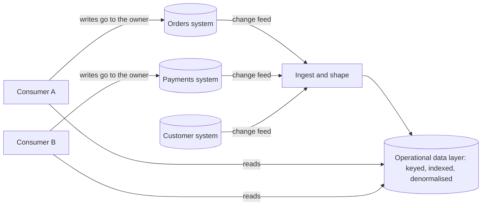

[Patterns](../patterns.md) › [Architecture patterns](README.md) › [System architectures](README.md#system-architectures)

# ARCH-1 Operational Data Fabric

Also known as: Operational data layer, data hub; Normalizer (EIP).

**Intent.** Give consumers one operational access layer over several systems of record, while each system keeps owning and writing its own data.

**Context.** This pattern extends the change-fed read model ([ARCH-8](arch-08-change-fed-read-model.md)) from one source to several. A business journey spans several systems (orders, payments, customers, inventory). Operational queries need data from more than one of them, and ownership of each data set stays with its system. Consumers need current data, not last night's batch.

**Problem.** How do you stop every consumer from fanning out to several systems and repeating the same aggregation, enrichment and correlation?

**Forces.**
- Fan-out calls multiply latency and load on every source, and every consumer re-implements the joins.
- Each source system must stay the owner of its data.
- Sources change at different rates and arrive with different lags.
- A shared layer attracts every new requirement and can grow without limit.

**Solution.**
1. Feed a copy of each source's operational data into one layer, through change data capture or published events.
2. Shape the copy for the journeys that use it: key it and index it for their lookups, and denormalise in the feed where a lookup would otherwise need a join at query time.
3. Consumers read from the layer. The layer is read-only for them: writes go to the owning system, and come back into the layer through its feed.
4. Record the source and the source version (or change position) with each record, so consumers can see how current it is.
5. Scope the layer by journey, with a named owner for each data set in it, and add data sets only when a journey needs them.

The layer is not a consistent snapshot across systems. Each source arrives with its own lag, so one view can combine a newer record from one system with an older record from another. Consumers that need cross-system consistency must check versions or go to the owners.

**Structure.**

**Hazelcast mechanics.**
- Feeds: CDC sources or Kafka into IMaps through pipelines ([ARCH-8](arch-08-change-fed-read-model.md), [IP-5](../caching-patterns/ip-05-refresh-ahead.md)); denormalise in the pipeline with enrichment and correlation stages ([STR-5](../streaming-patterns/str-05-enrichment-pipeline.md), [STR-4](../streaming-patterns/str-04-fan-in-fan-out.md)).
- Access and read semantics as in [ARCH-8](arch-08-change-fed-read-model.md): key lookups, indexes and SQL, with no point-in-time snapshot across partitions. SQL supports INNER, LEFT, RIGHT and CROSS joins between maps (no FULL join), and joins tables in the order they are written, without reordering them. For hot journeys, denormalise in the feed rather than join at query time.
- IMap is AP: during a split-brain, both sides keep serving their copy.

**Consequences.**
- (+) One place to query journey data; consumers stop fanning out to every source.
- (+) Source load falls, and query latency and source calls per request can be measured before and after.
- (−) The layer is eventually consistent per source and not consistent across sources.
- (−) Scope creep: without an owner per data set and a journey for each addition, the layer becomes an unowned copy of everything.
- (−) Data-quality problems in a source are copied into the layer; fix them at the source.
- (−) Do not use when one system already holds all the data a journey needs, when batch integration is enough, or when consumers do not need current data.

**Related patterns.** [ARCH-8](arch-08-change-fed-read-model.md), [ARCH-11](arch-11-orchestration-as-dataflow.md), [STR-4](../streaming-patterns/str-04-fan-in-fan-out.md), [STR-5](../streaming-patterns/str-05-enrichment-pipeline.md).

---

[ARCH-2 Brownout and Degraded Mode](arch-02-brownout-and-degraded-mode.md) →
