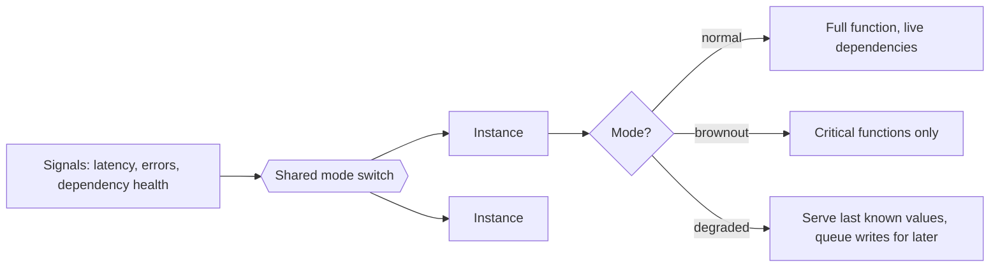

[Patterns](../patterns.md) › [Architecture patterns](README.md) › [System architectures](README.md#system-architectures)

# ARCH-2 Brownout and Degraded Mode

Also known as: Graceful degradation.

**Intent.** Under overload or dependency failure, switch off or simplify non-critical functions so that critical journeys keep working.

**Context.** Functions can be ranked by criticality, continuity matters more than completeness, and the ways dependencies fail can be foreseen.

**Problem.** How do you stop a slow or failed dependency, or a load spike, from turning into an all-or-nothing outage?

**Forces.**
- Without a plan, a slow dependency ties up threads and connections until everything fails.
- Two triggers need different responses: overload (brownout: dim optional work) and dependency failure (degraded mode: serve without that dependency).
- Every degraded behaviour is a code path that runs rarely and must still be tested.
- The cache or data layer that degraded mode relies on is itself a dependency.

**Solution.**
1. Classify functions as critical or optional, and list each one's dependencies, including hidden ones.
2. Define a degraded behaviour per dependency: serve the last known value, accept the request and complete it later, return a reduced response, or hide the feature.
3. Switch modes on measured signals (latency, error rate, saturation, dependency health), with hysteresis so modes do not flap, and keep the current mode in a shared switch that every instance reads.
4. Make sure the data needed for the degraded behaviour is actually available when the dependency is down: keep last known values for longer than their freshness limit, and serve them only in degraded mode, marked as such.
5. Plan for the data layer itself failing: decide what instances do when it is unreachable.
6. Test each mode regularly, for example by injecting the failure.

A copy of the data (a cache, a read model) adds resilience only if the system is designed to serve from it when the source fails; that design is this pattern.

**Structure.**

**Hazelcast mechanics.**
- Serving last known values: a `get` on an entry already in memory does not call the `MapLoader`, so present entries keep being served during a store outage; a missing entry triggers a load whose exception reaches the caller. Keep retention (TTL) longer than freshness and decide freshness from the value ([IP-24](../caching-patterns/ip-24-freshness-separate-from-ttl.md)).
- Writes during a store outage: write-behind keeps accepting writes in memory, within its loss budget ([IP-4](../caching-patterns/ip-04-write-behind.md), [IP-27](../caching-patterns/ip-27-write-behind-loss-budget-and-recovery.md)).
- Mode switch: a small IMap, or a ReplicatedMap for local reads on every member. ReplicatedMap is eventually consistent, so instances switch at slightly different moments; acceptable for a mode flag. Clients can listen for changes with entry listeners.
- Hazelcast itself unreachable: do not count on a client Near Cache to keep serving while the cluster is down. Plan the fallback in the application (go direct to the owner with a capacity limit, or serve a reduced response), or fail over to a second cluster with client failover (`ClientFailoverConfig`, used for blue-green deployments; Enterprise Edition).

**Consequences.**
- (+) Partial service instead of a full outage; critical journeys keep their availability target.
- (+) Time spent in each mode and critical-journey success rate can be measured.
- (−) Wrong prioritisation hides a function users actually depend on.
- (−) Hidden dependencies defeat the plan; they show up only when tested.
- (−) More code paths and more operational procedures.
- (−) Do not use when every function is equally critical, when partial operation is unacceptable, or when regulation forbids it.

**Related patterns.** [IP-24](../caching-patterns/ip-24-freshness-separate-from-ttl.md), [IP-6](../caching-patterns/ip-06-near-cache.md), [IP-4](../caching-patterns/ip-04-write-behind.md), [IP-27](../caching-patterns/ip-27-write-behind-loss-budget-and-recovery.md), [ARCH-6](arch-06-site-strategy-per-data-class.md), [ARCH-3](arch-03-burst-absorption.md).

---

← [ARCH-1 Operational Data Fabric](arch-01-operational-data-fabric.md) · [ARCH-3 Burst Absorption](arch-03-burst-absorption.md) →
