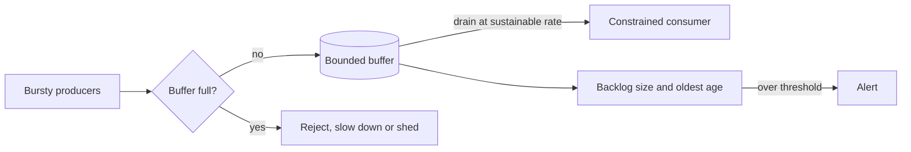

[Patterns](../patterns.md) › [Architecture patterns](README.md) › [System architectures](README.md#system-architectures)

# ARCH-3 Burst Absorption

Also known as: Load levelling, queue-based load levelling.

**Intent.** Put a bounded buffer between bursty producers and a constrained consumer, so a temporary spike is smoothed out instead of overwhelming the consumer.

**Context.** Peak demand is far above average for short periods; the consumer (often a system of record) cannot scale instantly; completing some work a little later is acceptable.

**Problem.** How do you survive spikes larger than the consumer's capacity without overprovisioning it for the peak?

**Forces.**
- Provisioning the consumer for the peak is expensive; provisioning for the average fails at the peak.
- A buffer adds latency, and work in it is not yet done.
- An unbounded buffer turns a spike into an out-of-memory failure.
- Buffering only works if, over time, demand stays below the consumer's capacity.

**Solution.**
1. Accept work into a buffer with a fixed capacity, and drain it at the rate the consumer can sustain.
2. When the buffer is full, push back at the boundary: reject, slow down, or shed low-priority work. Never let it grow without limit.
3. Make the backlog visible: its size and the age of its oldest item. Alert before the age exceeds what the business accepts.
4. Check the precondition: average demand over the burst window must be below drain capacity, or the backlog never recovers.
5. If work in the buffer must survive failures, make the buffer durable.
6. When the buffer holds writes, the system of record lags; reads that must see those writes have to come from the layer that holds them.
7. Do per-request work that has its own throughput limit (for example strongly consistent claims) after the buffer, at the drained rate, not in front of it.

**Structure.**

**Hazelcast mechanics.**
- Durable or large bursts: a durable log (such as Kafka) in front of a pipeline, with Jet backpressure pacing consumption to the slowest stage ([IP-14](../streaming-patterns/ip-14-backpressure.md)) and async batched calls to the consumer ([IP-16](../streaming-patterns/ip-16-async-batched-io.md)).
- In-memory buffers: an IQueue or a Ringbuffer is not partitioned. All its items live in one partition, on one member plus its backups, so a single one does not scale out, and its capacity is that member's memory. An IQueue is unbounded unless `max-size` is set, so set it. A Ringbuffer with `OverflowPolicy.FAIL` refuses new items when full; with `OVERWRITE` it drops the oldest, which is loss, not absorption. Both are in memory; durability needs a `QueueStore` / `RingbufferStore` or a durable log. To spread load, use several queues, one per key range.
- Writes towards a store: write-behind is a write buffer, bounded and measured as in [IP-27](../caching-patterns/ip-27-write-behind-loss-budget-and-recovery.md).
- CP claims are bounded per Raft group ([ARCH-5](arch-05-platform-level-idempotency.md)); at burst rate a per-request claim can become the bottleneck, so claim after the buffer or spread keys across several CP groups.

**Consequences.**
- (+) The consumer stays stable through spikes; peak capacity can be sized for the average plus the buffer.
- (+) Backlog size, oldest age, drain rate and rejected requests can be measured.
- (−) Latency grows with the backlog, and work in the buffer is not yet done.
- (−) Wrong sizing either rejects too early or holds too much for too long; recovery after a long spike is slow.
- (−) Do not use when synchronous completion is mandatory or no backlog is acceptable.

**Related patterns.** [IP-14](../streaming-patterns/ip-14-backpressure.md), [IP-16](../streaming-patterns/ip-16-async-batched-io.md), [IP-4](../caching-patterns/ip-04-write-behind.md), [IP-27](../caching-patterns/ip-27-write-behind-loss-budget-and-recovery.md), [ARCH-5](arch-05-platform-level-idempotency.md), [ARCH-2](arch-02-brownout-and-degraded-mode.md).

---

← [ARCH-2 Brownout and Degraded Mode](arch-02-brownout-and-degraded-mode.md) · [ARCH-4 Compute Near Data](arch-04-compute-near-data.md) →
