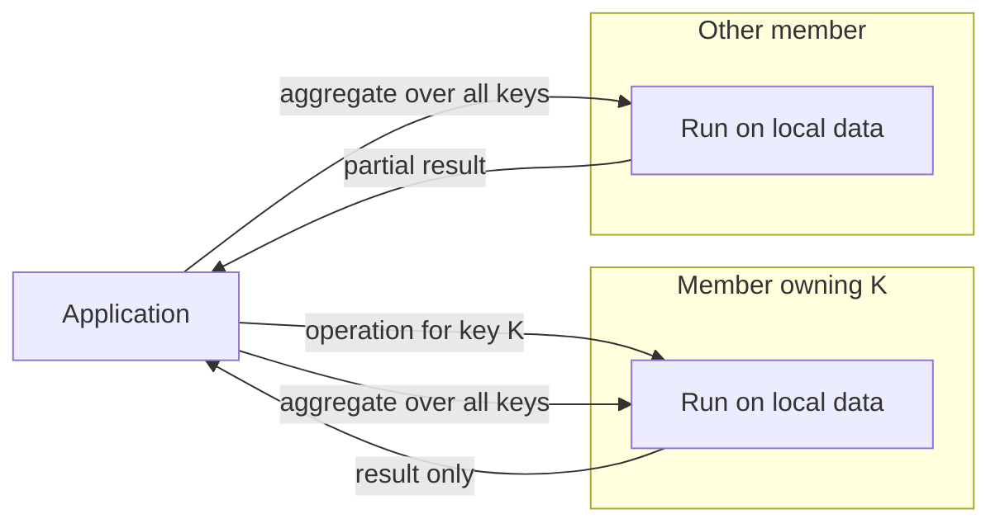

[Patterns](../patterns.md) › [Architecture patterns](README.md) › [System architectures](README.md#system-architectures)

# ARCH-4 Compute Near Data

Also known as: Data-local processing, function shipping; Scatter-Gather, Service Activator, Content Filter (EIP).

**Intent.** Send the processing to the nodes that hold the data, and return only the results, instead of moving the data to the processing.

**Context.** Requests or batch jobs read and update large amounts of partitioned operational data; moving it to an application tier dominates the cost; the processing can be expressed per key or per partition.

**Problem.** How do you stop the network from becoming the bottleneck when the application repeatedly pulls large amounts of data to work on it?

**Forces.**
- Pulling data to the application costs network, serialisation and round trips; a read-modify-write also needs concurrency control.
- Code that runs inside the data tier competes with data access for the same threads.
- Shipped code has to be deployed to the data nodes and kept in step with the clients that call it.
- Work that spans keys cannot all be local.

**Solution.**
1. Partition the data by the key the processing uses.
2. For a per-key change, send the operation to the key's owner and run it there, atomically, returning only the result.
3. For aggregations and filters over many keys, run them on every node over its own partitions, and combine the partial results.
4. Keep shipped operations short and free of blocking calls; anything slow runs elsewhere.
5. Make cross-key work explicit: it needs a shuffle or a second step.
6. Version shipped code and deploy it with the clients that call it.

For continuous streams, the equivalent is partitioned stream processing ([STR-11](../streaming-patterns/str-11-partitioned-compute.md)).

**Structure.**

**Hazelcast mechanics.**
- Per key: `EntryProcessor` with `executeOnKey`, or `executeOnEntries` with a predicate. It runs on the partition thread that owns the key: atomic per key, but it blocks that partition while it runs. By default a processor is re-run on each backup (except processors marked `ReadOnly`), so it must be deterministic: no clocks, random numbers or external calls inside. It should also be idempotent, because an operation retried after a member failure can apply twice.
- Many keys: `IMap.aggregate` with an `Aggregator`, and `IMap.project`, run on the members and return reduced results. SQL aggregations run in the cluster too.
- Arbitrary tasks: `IExecutorService.executeOnKeyOwner` runs a task on the member that owns a key. It is not an entry processor: nothing makes it atomic with other operations on that key, so use an entry processor for read-modify-write.
- Deploying code to members: User Code Namespaces (Enterprise Edition) deploy classes to members; prefer them over the older, deprecated User Code Deployment. In Community Edition, put the classes on the members' classpath. Jet jobs carry their own classes (`JobConfig.addClass` / `addJar`).

**Consequences.**
- (+) Network traffic and latency fall to the size of the results; per-key updates need no locks.
- (+) Data moved per request and end-to-end latency can be measured before and after.
- (−) A slow or blocking operation slows every client of that partition.
- (−) Observability is harder: the work runs inside the data tier, not in the application.
- (−) Deployment and versioning of shipped code adds an operational step.
- (−) Do not use when the data is small, the processing is light, or central execution is fast enough.

**Related patterns.** [STR-11](../streaming-patterns/str-11-partitioned-compute.md), [ARCH-9](arch-09-state-externalisation-with-in-place-updates.md), [ARCH-11](arch-11-orchestration-as-dataflow.md), [STR-5](../streaming-patterns/str-05-enrichment-pipeline.md).

---

← [ARCH-3 Burst Absorption](arch-03-burst-absorption.md) · [ARCH-5 Platform-Level Idempotency](arch-05-platform-level-idempotency.md) →
