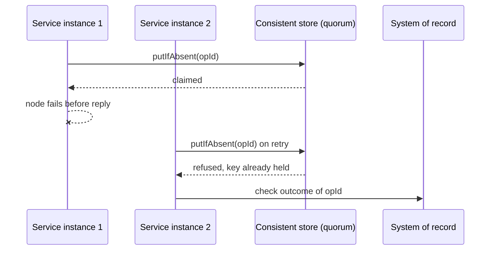

[Patterns](../patterns.md) › [Architecture patterns](README.md) › [Capability architectures](README.md#capability-architectures)

# ARCH-5 Platform-Level Idempotency

Also known as: Control-plane consistency.

**Intent.** Claim each operation's key once, atomically, in a strongly consistent store every service shares.

**Context.** Operations must execute exactly once through retries and failover. Locks and leader election are often built on a database by each service.

**Problem.** How do you make "execute once" a property of the platform rather than of each service's own locks?

**Forces.**
- Retries and failover are normal; duplicate side effects are not acceptable.
- Locks built on a database take several round trips, and fencing becomes custom code.
- Strong consistency costs availability: during a network split, the minority side stops.

**Solution.** Keep locks, leader election and idempotency keys in one strongly consistent store. Claim each operation's key atomically before the side effect, recording who claimed it and its status (claimed, done). A retry or failover finds the key already held and is refused. A claim can outlive the instance that made it, so the instance that is refused checks the system of record for the operation's outcome and completes or releases the claim; without that step a failed claim blocks the operation for ever.

**Structure.**

**Hazelcast mechanics.** CP Subsystem, which must be enabled with `cp-member-count` of at least 3. With the default of 0 it runs in "unsafe mode", backed by AP data structures, and gives none of the guarantees below; `CPMap` refuses to run in that mode. `CPMap.putIfAbsent` or `compareAndSet` for idempotency keys. `FencedLock` for mutual exclusion and as the usual building block for leader election; its fencing token protects the system of record only if the system of record checks it on every write. `CPMap` exists since 5.4. In Hazelcast 5.5 the CP Subsystem and `CPMap` are Enterprise Edition features.

**Consequences.**
- (+) Duplicate executions in failover tests can be measured, and driven to zero when the outcome check against the system of record is itself atomic.
- (−) Keep CP narrow: locks, counters, idempotency keys. Bulk data belongs in AP maps. Each CP group is one Raft log with one leader, so throughput is bounded per group; spread keys over several groups to scale. `CPMap` has no TTL (old keys must be deleted by your code) and a size limit (`max-size-mb`, 100 MB per map by default, at most 2,000 MB), held on heap.
- (−) CP needs a majority; a partitioned minority loses CP operations.
- (−) A cache alone does not give exactly-once: the key claim and the system of record's final state together do.

**Related patterns.** [IP-17](../streaming-patterns/ip-17-processing-guarantee.md), [ARCH-6](arch-06-site-strategy-per-data-class.md), [ARCH-9](arch-09-state-externalisation-with-in-place-updates.md), [ARCH-3](arch-03-burst-absorption.md) (claim after the buffer at burst rates).

---

← [ARCH-4 Compute Near Data](arch-04-compute-near-data.md) · [ARCH-6 Site Strategy per Data Class](arch-06-site-strategy-per-data-class.md) →
