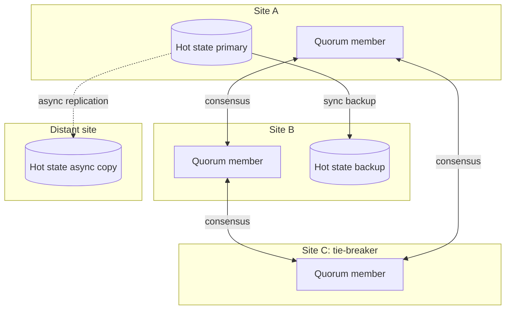

[Patterns](../patterns.md) › [Architecture patterns](README.md) › [Capability architectures](README.md#capability-architectures)

# ARCH-6 Site Strategy per Data Class

**Intent.** Give each class of data its own resilience strategy across sites.

**Context.** The system runs on two or more sites; recovery after losing a site is often manual.

**Problem.** How do you survive losing a site without manual data recovery, when different data has different consistency needs?

**Forces.**
- Strongly consistent data needs a majority quorum, and every write to it waits for that quorum, so inter-site latency adds to write latency.
- Asynchronous cross-region replication loses in-flight updates when a region is lost.
- Distance adds latency that no configuration removes.

**Solution.** Classify data and pick a strategy per class, each with a stated recovery point and recovery time:
- coordination data (locks, idempotency keys): a strongly consistent quorum spread over three sites, so losing any one site keeps a majority;
- hot operational state: synchronous copies on a nearby site, so losing one site loses no acknowledged write;
- a distant copy for disaster recovery: asynchronous replication, accepting the loss of in-flight updates.

**Structure.**

**Hazelcast mechanics.** CP Subsystem, with CP members on all three sites; a cluster stretched across low-latency sites with a partition group (`ZONE_AWARE`, `PLACEMENT_AWARE` or `CUSTOM`) so that each backup lands on a different site from its primary; split-brain protection and merge policies for the stretched cluster; WAN replication with merge policies; client failover (`ClientFailoverConfig`). WAN replication, CP Subsystem and client failover are Enterprise Edition features. The member on the tie-breaker site is a full cluster member, so a zone-aware partition group also places AP partitions and backups there; size it accordingly.

**Consequences.**
- (+) An explicit, testable recovery point and recovery time per data class.
- (−) WAN replication copies maps and caches, not CP data or running jobs' state.
- (−) A cluster stretched across two sites can split in two; both halves keep serving AP data unless split-brain protection stops the minority, and the data is merged by policy when they rejoin.
- (−) A three-site quorum works only if site-to-site latency is low; test it before committing.

**Related patterns.** [ARCH-5](arch-05-platform-level-idempotency.md), [ARCH-9](arch-09-state-externalisation-with-in-place-updates.md), [ARCH-2](arch-02-brownout-and-degraded-mode.md) (what the application does while a site or the cluster is down).

---

← [ARCH-5 Platform-Level Idempotency](arch-05-platform-level-idempotency.md) · [ARCH-7 Shared Reference Map with Near Cache](arch-07-shared-reference-map-with-near-cache.md) →
