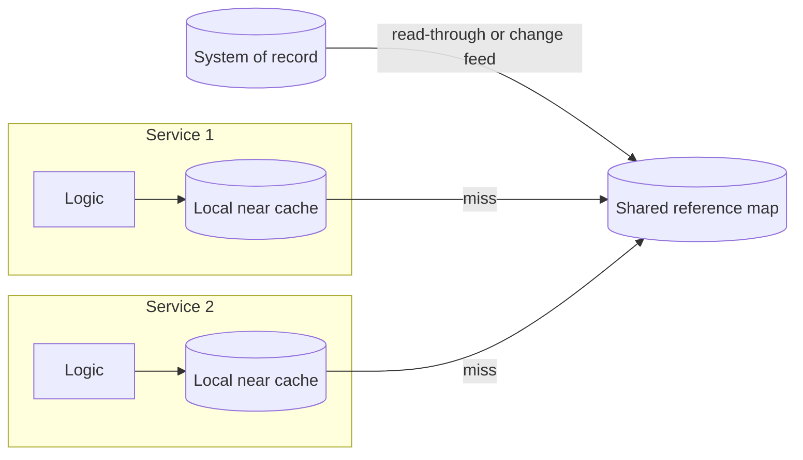

[Patterns](../patterns.md) › [Architecture patterns](README.md) › [Capability architectures](README.md#capability-architectures)

# ARCH-7 Shared Reference Map with Near Cache

Also known as: Reference-data cache. A narrow case of read acceleration; see [ARCH-8](arch-08-change-fed-read-model.md) for the general case.

**Intent.** Serve configuration and reference data from memory, shared by all services.

**Context.** Immutable or slow-changing values (configuration, static codes, lookup tables) are read from the store on every request.

**Problem.** How do you take repeat reference reads off the store and off the critical path?

**Forces.**
- Lookups are on the critical path.
- A separate cache per service duplicates data and logic.
- A local copy is eventually consistent.

**Solution.** Load reference values into one shared map, refresh it when a value changes, and add a local near cache in each service for repeat reads. The store stays the system of record.

**Structure.**

**Hazelcast mechanics.** IMap with `MapLoader` ([IP-2](../caching-patterns/ip-02-read-through.md)) or change-fed refresh ([IP-5](../caching-patterns/ip-05-refresh-ahead.md)); Near Cache ([IP-6](../caching-patterns/ip-06-near-cache.md)).

**Consequences.**
- (+) Repeat lookups leave the store; lookup p99 and store reads per request can be measured before and after.
- (−) Suited to values that rarely change. Anything that must be exactly current is read from the system of record: the shared map is itself a copy, and a Near Cache adds a further, bounded staleness ([IP-6](../caching-patterns/ip-06-near-cache.md)).

**Related patterns.** [IP-2](../caching-patterns/ip-02-read-through.md), [IP-5](../caching-patterns/ip-05-refresh-ahead.md), [IP-6](../caching-patterns/ip-06-near-cache.md), [ARCH-8](arch-08-change-fed-read-model.md).

---

← [ARCH-6 Site Strategy per Data Class](arch-06-site-strategy-per-data-class.md) · [ARCH-8 Change-Fed Read Model](arch-08-change-fed-read-model.md) →
