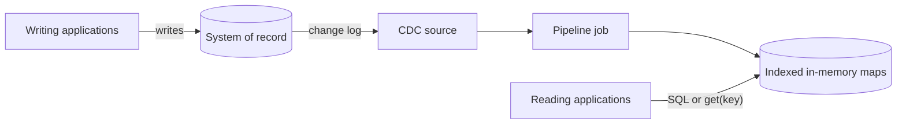
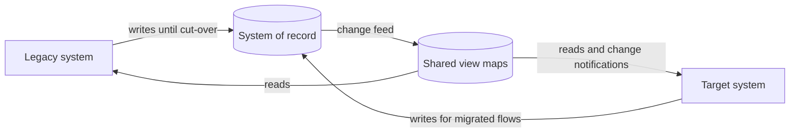

[Patterns](../patterns.md) › [Architecture patterns](README.md) › [Capability architectures](README.md#capability-architectures)

# ARCH-8 Change-Fed Read Model

Also known as: System-of-record offload, read acceleration, coexistence view (migration variant); Channel Adapter (EIP).

**Intent.** Serve reads from a CDC-fed in-memory copy while the store keeps every write.

**Context.** Applications read from the system of record at high rate, and reads compete with writes for its capacity.

**Problem.** How do you offload reads without changing the applications that write?

**Forces.**
- The store must stay authoritative and keep every write.
- Lookups are by more than one field, not only by key.
- A CDC copy lags the source slightly.

**Solution.** Stream the store's changes into maps with CDC, and serve lookups from the maps by key or SQL. Writers keep writing to the store unchanged.

**Structure.**

**Hazelcast mechanics.** Debezium-based CDC sources (Enterprise Edition; Community Edition has the legacy connector) and `CdcSinks.map`, or an existing CDC tool into Kafka; IMap indexes and SQL (each map needs a mapping). A SQL query reads partitions one by one, not from a single point-in-time snapshot, so a multi-row result can mix older and newer rows.

**Consequences.**
- (+) Store CPU and reads per request drop, and the change can be measured.
- (+) Writers are not changed.
- (−) Reads that must see the latest write stay on the store. That includes a writer reading its own write: it may not have arrived through CDC yet.
- (−) CDC is at-least-once; in-order upserts and deletes keep the copy correct ([IP-5](../caching-patterns/ip-05-refresh-ahead.md)).

**Variant: migration coexistence.** Also known as: Coexistence view, modernisation coexistence.

During a long migration, legacy and target systems run side by side while flows move over one at a time, and both need the same current data without a sync or dual write per flow. Use the same change-fed copy, readable by both generations:
1. The legacy system keeps writing to the system of record until each of its flows is cut over; the target system writes the flows it already owns. Each flow has exactly one writer at a time.
2. Both generations read the shared copy; the target system is also notified of changes, so it can react without polling.
3. Cut flows over one at a time; no big-bang switch.

Hazelcast mechanics for the variant: entry listeners or map journals notify the target system. Entry listeners are not durable: events sent while a client is disconnected are lost, so use the map journal (replayable within its capacity) or reconcile on reconnect when every change matters.

Consequences of the variant:
- (+) One change feed instead of one sync per flow; a data-side companion to the Strangler Fig migration pattern.
- (−) Both systems write to the same store during the migration, so flow ownership must be explicit, and a system reading the view may not yet see its own write.

**Related patterns.** [IP-5](../caching-patterns/ip-05-refresh-ahead.md) is the same feed at cache level. [ARCH-1](arch-01-operational-data-fabric.md) extends this pattern to several sources, and the migration variant above applies it to moving off a legacy store. [ARCH-7](arch-07-shared-reference-map-with-near-cache.md) covers reference data. [ARCH-2](arch-02-brownout-and-degraded-mode.md): the copy adds resilience only with a degraded mode that serves from it.

---

← [ARCH-7 Shared Reference Map with Near Cache](arch-07-shared-reference-map-with-near-cache.md) · [ARCH-9 State Externalisation with In-Place Updates](arch-09-state-externalisation-with-in-place-updates.md) →
