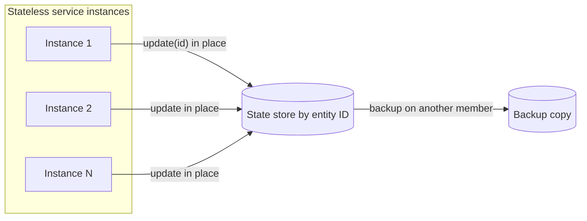

[Patterns](../patterns.md) › [Architecture patterns](README.md) › [Capability architectures](README.md#capability-architectures)

# ARCH-9 State Externalisation with In-Place Updates

**Intent.** Move service state into a shared data layer and update it where it lives, so services scale out and recover.

**Context.** Services keep in-flight state in process memory and cannot scale out; a lost instance needs manual recovery.

**Problem.** How do you make stateful services elastic and fault-tolerant?

**Forces.**
- Services need fast, atomic state updates per step.
- Moving state to a database adds read-and-write-back round trips.
- Rewriting a service at once is too risky.

**Solution.** Keep in-flight state (status, step) in a shared, partitioned store keyed by entity ID, and run each update where the entity's state lives, atomically per entity ([ARCH-4](arch-04-compute-near-data.md)). Assign each entity to one instance at a time (for example by message-partition ownership), so two instances do not run the same entity's steps concurrently. Idempotency keys belong in a strongly consistent store ([ARCH-5](arch-05-platform-level-idempotency.md)), not in this state store. Services become stateless, and any instance can continue any entity's work.

**Structure.**

**Hazelcast mechanics.** IMap with backups; `EntryProcessor` via `executeOnKey`, following the rules in [ARCH-4](arch-04-compute-near-data.md) (short, non-blocking, deterministic, idempotent). The IMap is AP: during a split-brain, both sides can update the same entity, and the merge policy keeps one side's state, so a step can be lost; use split-brain protection on the map if that is not acceptable.

**Consequences.**
- (+) New instances share the load; a survivor picks up a failed instance's work.
- (−) Services must read and write state per step, and work must be reassigned on failure (for example by a Kafka consumer-group rebalance).
- (−) Move one stage at a time. Duplicate side effects are still handled by [ARCH-5](arch-05-platform-level-idempotency.md).
- (−) The state store is now on every step's critical path; plan for it being unavailable ([ARCH-2](arch-02-brownout-and-degraded-mode.md)).

**Related patterns.** [ARCH-5](arch-05-platform-level-idempotency.md), [ARCH-4](arch-04-compute-near-data.md), [IP-18](../streaming-patterns/ip-18-partitioned-compute.md), [ARCH-6](arch-06-site-strategy-per-data-class.md).

---

← [ARCH-8 Change-Fed Read Model](arch-08-change-fed-read-model.md) · [ARCH-10 Live Operational View](arch-10-live-operational-view.md) →
