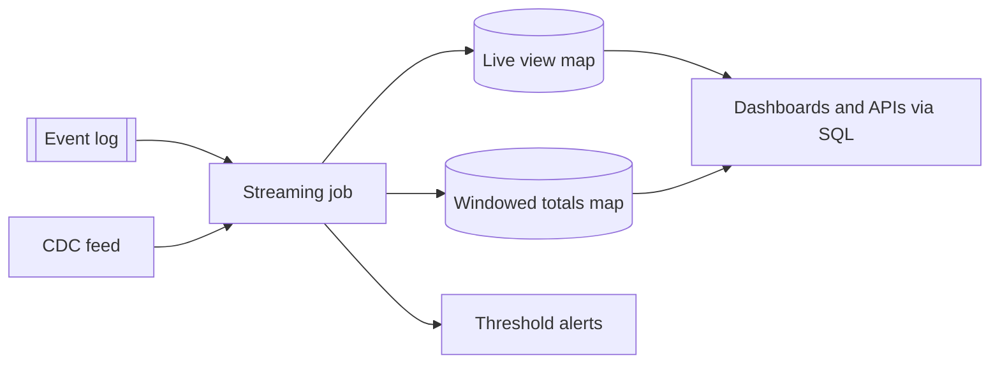

[Patterns](../patterns.md) › [Architecture patterns](README.md) › [Capability architectures](README.md#capability-architectures)

# ARCH-10 Live Operational View

Also known as: Kappa-style live view, streaming materialised view.

**Intent.** A streaming job maintains live views and windowed totals in memory.

**Context.** Decisions depend on data that reaches the analytics store only after a batch ETL.

**Problem.** How do you let teams act on the current position rather than the last batch?

**Forces.**
- Batch loads are late by design.
- A live store fed by its own integration would have to be kept in step with the analytics store.
- A live view shows the present; it does not forecast.

**Solution.** One durable event log (plus change data capture where needed) feeds a streaming job that keeps live views and windowed totals in maps, served by key or SQL, with alerts when thresholds are crossed. Replaying the log rebuilds the views where retention allows.

**Structure.**

**Hazelcast mechanics.** Pipeline with Kafka or CDC sources; sliding or tumbling windows; IMap sinks; SQL; snapshots for restart. A window emits only after the watermark passes its end, so a total arrives at least one window length (plus allowed lag) late; use early results (`setEarlyResultsPeriod`) or `rollingAggregate` for values that must move with every event. Rebuilding a view by replay means running the job again into an emptied or new map.

**Consequences.**
- (+) Alerts fire when the event happens, not after the batch.
- (+) No separate synchronisation to maintain: the views are derived from the same log as everything else.
- (−) SQL reads are not a point-in-time snapshot across keys, so a dashboard can briefly show totals that do not add up.
- (−) History stays in the log and the analytics store.

**Related patterns.** [STR-2](../streaming-patterns/str-02-journal-chained-stages.md), [STR-4](../streaming-patterns/str-04-fan-in-fan-out.md), [STR-10](../streaming-patterns/str-10-processing-guarantee.md), [ARCH-11](arch-11-orchestration-as-dataflow.md), [ARCH-4](arch-04-compute-near-data.md) (query and aggregate the views in place).

---

← [ARCH-9 State Externalisation with In-Place Updates](arch-09-state-externalisation-with-in-place-updates.md) · [ARCH-11 Orchestration as Dataflow](arch-11-orchestration-as-dataflow.md) →
