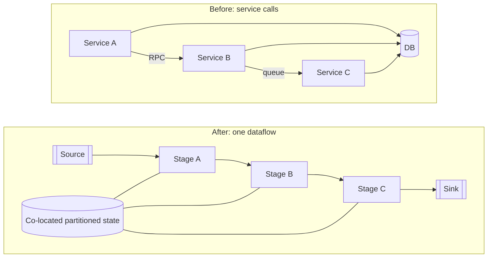

[Patterns](../patterns.md) › [Architecture patterns](README.md) › [Capability architectures](README.md#capability-architectures)

# ARCH-11 Orchestration as Dataflow

Also known as: Service-data orchestration.

**Intent.** Run chatty service-to-service stages as one streaming DAG with co-located state.

**Context.** Chains of RPC, queue and database calls between services dominate latency.

**Problem.** How do you keep the modularity of microservices without the coordination cost of distributed state?

**Forces.**
- Service boundaries help teams; network calls between them cost latency.
- A big-bang rewrite is not acceptable; adoption must be stage by stage.

**Solution.** Express the chatty stages as a streaming DAG. Partition state in memory and co-locate it with the compute, so each stage reads its state locally. Adopt it one stage at a time, only where it pays off.

**Structure.**

**Hazelcast mechanics.** Pipelines; partitioned IMap state; journal chaining ([STR-2](../streaming-patterns/str-02-journal-chained-stages.md)); partitioned compute ([STR-11](../streaming-patterns/str-11-partitioned-compute.md)).

**Consequences.**
- (+) Lower latency with fewer moving parts.
- (−) An option for hot paths, not a prerequisite for the other patterns.
- (−) Stages in one job deploy together: changing one stage means restarting or upgrading the whole job. [STR-2](../streaming-patterns/str-02-journal-chained-stages.md) keeps stages in separate jobs if that matters.
- (−) Effects on external systems still need [ARCH-5](arch-05-platform-level-idempotency.md) or a transactional sink ([STR-10](../streaming-patterns/str-10-processing-guarantee.md)).

**Related patterns.** [ARCH-4](arch-04-compute-near-data.md), [STR-1](../streaming-patterns/str-01-template-jobs.md), [STR-2](../streaming-patterns/str-02-journal-chained-stages.md), [STR-11](../streaming-patterns/str-11-partitioned-compute.md), [ARCH-10](arch-10-live-operational-view.md).

---

← [ARCH-10 Live Operational View](arch-10-live-operational-view.md)
