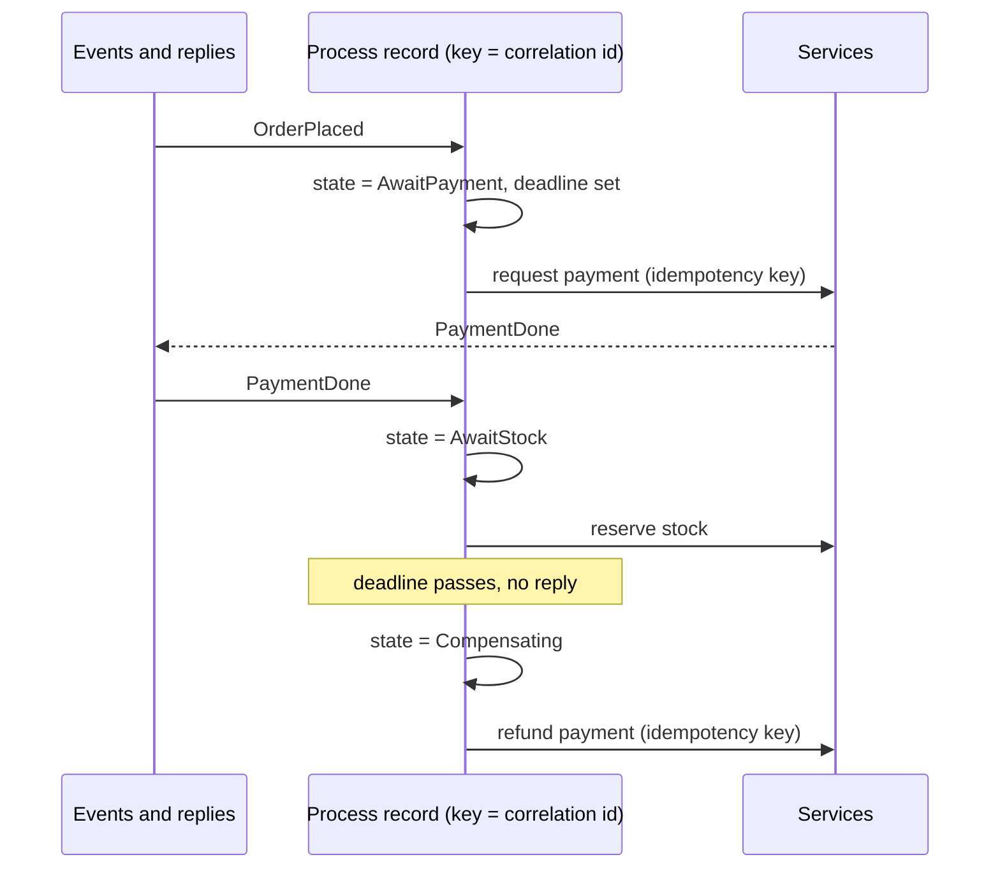

[Patterns](../patterns.md) › [Architecture patterns](README.md) › [Capability architectures](README.md#capability-architectures)

# ARCH-12 Process Manager with Keyed State

Also known as: Process Manager (EIP), saga orchestrator. Also replaces Routing Slip (EIP) where the next step depends on earlier results.

**Intent.** Track each instance of a multi-step business process as one record keyed by its correlation id, advance it atomically on each event, and act on time-outs.

**Context.** A business process spans several services and takes seconds to days: an order that needs payment, stock and shipping. Each step sends a request and waits for a reply or an event. Steps can fail, arrive late, or never arrive.

**Problem.** How do you coordinate a long-running process across services so that every instance reaches a defined end, through failures and lost replies?

**Forces.**
- Process state must survive the failure of the instance that drives it.
- Events for one process instance can arrive concurrently and out of order.
- Steps cause external effects that cannot be rolled back, only compensated.
- A reply that never arrives must not leave the process stuck for ever.
- Many instances run at once, so the coordinator must scale out.

**Solution.**
1. Model the process as a state machine: states, the events each state accepts, and the actions each transition triggers.
2. Keep one record per process instance, keyed by its correlation id, holding the current state, the steps done, and a deadline.
3. Route every event about an instance to its record and apply the transition atomically on that record. Reject or ignore events the current state does not accept (late or duplicate replies).
4. Perform the transition's external action after the state change is recorded, with an idempotency key made from the instance id and step, so a retry does not repeat the effect.
5. Each state that waits has a deadline. When it passes, apply a time-out transition: retry, take an alternative path, or start compensation.
6. Compensate completed steps in reverse order when the process cannot finish. Compensations are steps too and need idempotency keys.
7. Every instance ends in a terminal state (done, compensated, failed for manual handling). Keep terminal records for an audit period, then remove them.

**Structure.**

**Hazelcast mechanics.** Two ways to hold the process state:
- **IMap record per instance.** Advance it with an `EntryProcessor` on the correlation key: the transition is atomic per key and runs where the record lives, following the rules in [ARCH-4](arch-04-compute-near-data.md) (short, deterministic, no external calls inside). Feed events from a pipeline, an entry listener or the map journal. Find expired deadlines with an indexed query on the deadline field, run periodically (for example from `IScheduledExecutorService`), or with a pipeline. The records are queryable with SQL for operations and audit.
- **Keyed state inside one job.** `groupingKey(correlationId).mapStateful(...)` or `flatMapStateful(...)`, with the TTL and eviction callback as the time-out. State lives in the job's snapshots, so it is consistent with the job's processing guarantee, but it is not visible outside the job, and the TTL runs in event time, so a time-out fires only while events keep arriving.

The IMap is AP: during a split-brain, both sides can advance the same instance, and the merge policy keeps one side's record, so a transition can be lost; use split-brain protection on the map if that is not acceptable. Transitions are atomic only within one record; anything that touches two instances is two steps. External effects need an idempotency key in a strongly consistent store or in the target system ([ARCH-5](arch-05-platform-level-idempotency.md)).

**Consequences.**
- (+) Process state is explicit, survives instance failure, and is queryable.
- (+) Coordinators scale out: instances spread over partitions.
- (+) Late, duplicate and missing replies have defined handling.
- (−) The state machine, the compensations and the time-out scan are application code.
- (−) A central coordinator couples to every service it calls; choreography by events is the alternative when that coupling is unwanted.
- (−) Deadlines in event time (job state) and wall-clock time (IMap scan) behave differently; pick one per process.

**Related patterns.** [ARCH-9](arch-09-state-externalisation-with-in-place-updates.md) (the per-entity state this builds on), [ARCH-5](arch-05-platform-level-idempotency.md), [ARCH-4](arch-04-compute-near-data.md), [STR-4](../streaming-patterns/str-04-fan-in-fan-out.md), [STR-12](../streaming-patterns/str-12-dead-letter-side-output.md), [ARCH-14](arch-14-request-reply-over-the-grid.md).

---

← [ARCH-11 Orchestration as Dataflow](arch-11-orchestration-as-dataflow.md) · [ARCH-13 Server-Side Filtered Subscriptions](arch-13-server-side-filtered-subscriptions.md) →
