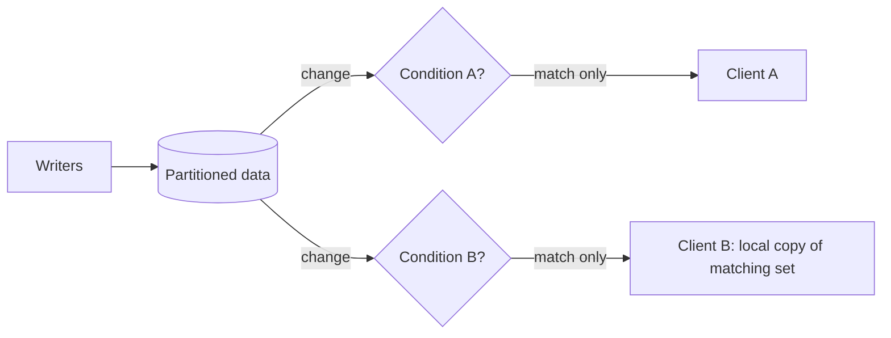

[Patterns](../patterns.md) › [Architecture patterns](README.md) › [Capability architectures](README.md#capability-architectures)

# ARCH-13 Server-Side Filtered Subscriptions

Also known as: Selective Consumer (EIP), continuous query.

**Intent.** Let each client subscribe to only the changes that match its condition, with the condition evaluated where the data lives, and optionally keep a local copy of the matching set.

**Context.** Many clients (desks, devices, services) each care about a small slice of a large, changing data set: one region's orders, one customer's positions, alerts above a threshold.

**Problem.** How do you push relevant changes to each client without sending every change to every client or having each one poll?

**Forces.**
- Sending every change to every client wastes network and client CPU.
- Polling adds load and latency.
- Push notifications are not durable: a client that disconnects misses changes.
- A local copy of the matching set makes reads instant, but must be resynchronised after a gap.

**Solution.**
1. Each client registers its condition with the data layer.
2. The data layer evaluates the condition on each change where the change happens, and sends only matching changes to that client.
3. For clients that read the matching set often, keep a local copy that the data layer keeps current.
4. On reconnect, or when the data layer reports lost events, resynchronise: re-read the matching set rather than trusting the stream.
5. Keep conditions cheap: they run on every change.

**Structure.**

**Hazelcast mechanics.**
- Filtered push: `IMap.addEntryListener(listener, predicate, includeValue)`. The predicate is evaluated on the members, so non-matching events are not sent. Setting `includeValue` to false sends keys only. Entry listener events are not durable: events fired while the client is disconnected are lost.
- Local matching copy: Continuous Query Cache (`IMap.getQueryCache(name, predicate, includeValue)`), available in Community Edition. It is populated from the map and then kept current by events, buffered on the members per partition (`buffer-size`, default 16) and sent in batches. It is eventually consistent. A listener may receive the same event more than once after a failure; an `EventLostListener` reports lost events and `tryRecover()` attempts recovery. Entries removed from the IMap by eviction are not removed from the query cache; explicit `evict` calls are. Indexes on the query cache can lag its entries slightly.
- Replay: for consumers that must not miss changes, read the map journal with a pipeline instead ([STR-2](../streaming-patterns/str-02-journal-chained-stages.md)); it is replayable within its capacity.

**Consequences.**
- (+) Network traffic scales with matching changes, not all changes.
- (+) Clients read their slice from local memory, with no round trip.
- (−) Not durable; clients must resynchronise after gaps.
- (−) Every condition runs on every change of the map; many complex conditions add member CPU.
- (−) The local copy uses client memory and lags the map slightly.

**Related patterns.** [IP-6](../caching-patterns/ip-06-near-cache.md) (local copy by key rather than by condition), [ARCH-8](arch-08-change-fed-read-model.md), [ARCH-10](arch-10-live-operational-view.md), [STR-14](../streaming-patterns/str-14-topic-based-publish-subscribe.md).

---

← [ARCH-12 Process Manager with Keyed State](arch-12-process-manager-with-keyed-state.md) · [ARCH-14 Request-Reply over the Grid](arch-14-request-reply-over-the-grid.md) →
