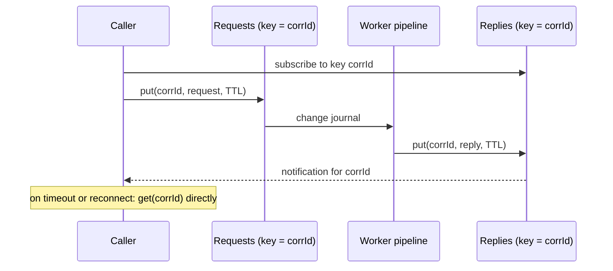

[Patterns](../patterns.md) › [Architecture patterns](README.md) › [Capability architectures](README.md#capability-architectures)

# ARCH-14 Request-Reply over the Grid

Also known as: Request-Reply, Return Address, Correlation Identifier (EIP).

**Intent.** Let a caller submit a request for asynchronous processing and pick up the reply by a correlation id, through shared memory instead of a broker.

**Context.** Work is done by a pipeline or a pool of workers, not by the caller. The caller needs an answer, but processing may take longer than a synchronous call should, or involves several stages.

**Problem.** How do you get a reply back to the right caller when the work is done asynchronously, and the caller may fail or reconnect in between?

**Forces.**
- A synchronous call to the data is simpler when one atomic operation on one record answers the request.
- Asynchronous processing decouples caller and worker, but needs a way back.
- Notifications are not durable; a reply sent while the caller is away is missed.
- Requests and replies that nobody collects must not accumulate.

**Solution.**
1. **First check whether you need it.** If one operation on one record, or one task, answers the request, call it directly and wait for the result. Use this pattern only when the work is asynchronous or multi-stage.
2. The caller writes the request under a new correlation id, with a deadline.
3. Workers or a pipeline process the request and write the reply under the same correlation id.
4. The caller waits for the reply by correlation id: a notification for that key, with a timeout. On reconnect or timeout, it reads the reply directly, because the notification may have been missed.
5. Requests and replies expire after their deadline plus a margin.
6. Make processing idempotent by correlation id: a caller that retries after a timeout must not cause the work to run twice.

**Structure.**

**Hazelcast mechanics.** Direct alternatives first: `EntryProcessor` with `executeOnKey` returns a result and runs atomically where the record lives; `IExecutorService` (`submitToKeyOwner`) returns a future ([ARCH-4](arch-04-compute-near-data.md)). For the asynchronous pattern: a requests IMap with the event journal enabled as the pipeline's source ([STR-2](../streaming-patterns/str-02-journal-chained-stages.md)); a replies IMap written by the pipeline's sink; the caller registers `addEntryListener` for its correlation key before writing the request, so it cannot miss a fast reply, then falls back to `get` on timeout. Per-entry TTLs on both maps bound memory. Co-partitioning request and reply by correlation id keeps the reply write local. Both maps are AP: a request or reply can be lost if members fail beyond the backup count, so the caller's timeout must lead to a retry, and the retry must be safe ([ARCH-5](arch-05-platform-level-idempotency.md)).

**Consequences.**
- (+) Callers and workers are decoupled; workers scale independently.
- (+) Requests and replies are queryable while in flight, which helps operations.
- (−) More moving parts than a direct call; latency includes a journal hop and a notification.
- (−) Correctness depends on timeouts, retries and idempotency written by the application.

**Related patterns.** [ARCH-4](arch-04-compute-near-data.md), [ARCH-5](arch-05-platform-level-idempotency.md), [ARCH-12](arch-12-process-manager-with-keyed-state.md), [STR-2](../streaming-patterns/str-02-journal-chained-stages.md), [ARCH-13](arch-13-server-side-filtered-subscriptions.md).

---

← [ARCH-13 Server-Side Filtered Subscriptions](arch-13-server-side-filtered-subscriptions.md)
