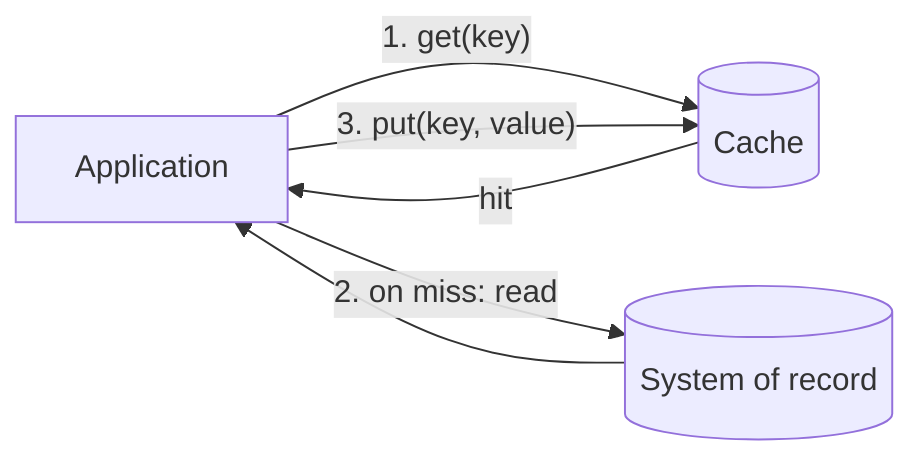

[Patterns](../patterns.md) › [Caching patterns](README.md) › [Access patterns](README.md#access-patterns)

# IP-1 Cache-Aside

**Intent.** The application owns the cache logic and falls back to the database on a miss.

**Context.** An application reads data held in a system of record, and a cache sits beside it.

**Problem.** How does the application get fast reads without the cache knowing about the data store?

**Forces.**
- Reads should be fast.
- The cache cluster should not carry data-store access code or credentials.
- Every application that uses the data must repeat the same cache logic.
- Other writers can change the system of record without touching the cache.

**Solution.** On a read, the application checks the cache. On a miss it reads from the database and, optionally, puts the result in the cache. On a write it updates the database first and then removes the cache entry (removing is safer than updating it, because two concurrent writers can otherwise leave the older value in the cache).

**Structure.**

**Hazelcast mechanics.** Plain `IMap.get` / `IMap.set` (or `put`) from the client, with no `MapLoader` configured. `IMap.delete` to invalidate. Use TTL or max-idle settings to bound staleness, since writers that bypass the application never invalidate the cache.

**Consequences.**
- (+) The cache cluster stays generic, with no dependency on the data store.
- (−) Load logic is duplicated in every application.
- (−) Two clients can race to populate the same key. A reader that loaded an old value before a write can put it back after the writer's invalidation; TTL bounds how long that stale value survives. `putIfAbsent` avoids overwriting a fresher entry but does not close this race; load tokens do ([IP-22](ip-22-stale-fill-prevention-with-load-tokens.md)).
- (−) Staleness is the application's problem.

**Related patterns.** [IP-2](ip-02-read-through.md) moves the miss logic into the cache. [IP-22](ip-22-stale-fill-prevention-with-load-tokens.md) closes the stale re-population race; [IP-23](ip-23-miss-coalescing.md) collapses concurrent misses; [IP-19](ip-19-negative-caching.md) caches absent keys.

---

[IP-2 Read-Through](ip-02-read-through.md) →
