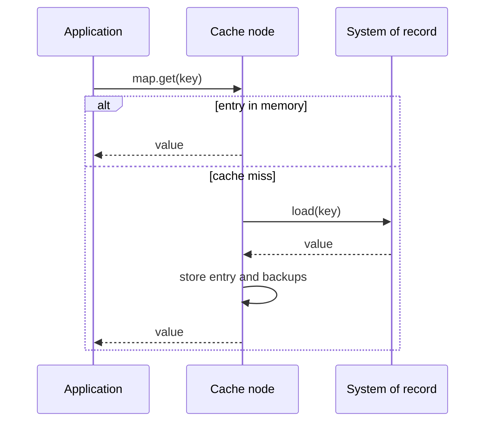

[Patterns](../patterns.md) › [Caching patterns](README.md) › [Access patterns](README.md#access-patterns)

# IP-2 Read-Through

**Intent.** The cache loads a missing entry from the store on the client's behalf.

**Context.** Many services read the same data from the same store.

**Problem.** How do you keep the miss-and-load logic in one place?

**Forces.**
- Centralising load logic removes duplication across services.
- The cluster now depends on the store's availability and latency on a miss.
- Loading the whole data set up front can take a long time and memory; loading lazily makes first reads slow.

**Solution.** The cache handles the entire read. On a miss, the cache node that owns the key loads the entry from the store, keeps it, and returns it.

**Structure.**

**Hazelcast mechanics.** `MapLoader` configured on the IMap. Pre-loading is controlled by `loadAllKeys`: if it returns keys, Hazelcast loads them the first time the map is touched (`initial-load-mode: LAZY`, the default) or when it is created (`EAGER`). Return `null` from `loadAllKeys` to load only on demand. Loaded entries are not written back to the store.

**Consequences.**
- (+) One simple API for clients; load logic lives once, on the cluster.
- (−) The first read of each key pays the store's latency.
- (−) A key that does not exist in the store is not cached (a `null` load stores nothing), so repeated reads of missing keys reach the store every time. Cache a marker if that matters ([IP-19](ip-19-negative-caching.md)).
- (−) Entries changed in the store by other writers stay stale until they expire or are evicted; set TTL or max-idle, or combine with [IP-5](ip-05-refresh-ahead.md).
- (−) Loader code is deployed to the cluster and versioned with it.

**Related patterns.** [IP-1](ip-01-cache-aside.md), [IP-5](ip-05-refresh-ahead.md), [IP-6](ip-06-near-cache.md), [IP-19](ip-19-negative-caching.md), [IP-23](ip-23-miss-coalescing.md), [IP-25](ip-25-selective-warm-up.md), [ARCH-7](../architecture-patterns/arch-07-shared-reference-map-with-near-cache.md).

---

← [IP-1 Cache-Aside](ip-01-cache-aside.md) · [IP-3 Write-Through](ip-03-write-through.md) →
