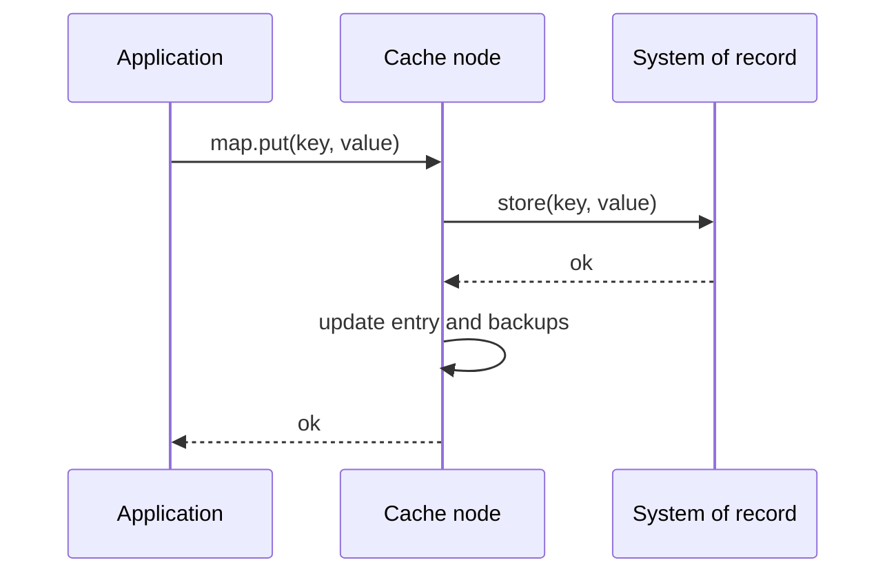

[Patterns](../patterns.md) › [Caching patterns](README.md) › [Access patterns](README.md#access-patterns)

# IP-3 Write-Through

**Intent.** Every write reaches the store before the caller is told it succeeded.

**Context.** A cache holds the hot copy of data, and the system of record must stay authoritative.

**Problem.** How do you keep cache and store in step on every write?

**Forces.**
- Consistency between cache and store matters more than write latency.
- Every write now pays the store's latency.
- The cache and the store are two systems, so a single write cannot be atomic across both.

**Solution.** The cache handles the entire write. A write calls the store synchronously on the cache node that owns the key; if the store fails, the error reaches the caller.

**Structure.**

**Hazelcast mechanics.** `MapStore` with `write-delay-seconds: 0`; `put` calls `MapStore.store` synchronously on the owning member, and an exception from `store` reaches the caller. `putAll` calls `storeAll`. Make `store` idempotent (an upsert keyed by the entry key): an operation retried after a member failure can call it again for the same entry.

**Consequences.**
- (+) Cache and store do not diverge on the happy path.
- (−) Write latency and throughput are bounded by the store.
- (−) If the store is down, writes fail.
- (−) Off the happy path they can diverge: a store call that times out after the database committed reports a failure to the caller although the store holds the value, and writers that bypass Hazelcast leave the cache stale.
- (−) The IMap is an AP structure: during a split-brain, both sides keep accepting writes and storing them, so the store can end up with whichever side wrote last. Use split-brain protection on the map if that is not acceptable.

**Related patterns.** [IP-4](ip-04-write-behind.md) trades consistency for latency. [IP-26](ip-26-retry-safe-mapstore-batches.md) makes `store` safe to repeat. [IP-12](../streaming-patterns/ip-12-durable-maps.md).

---

← [IP-2 Read-Through](ip-02-read-through.md) · [IP-4 Write-Behind](ip-04-write-behind.md) →
