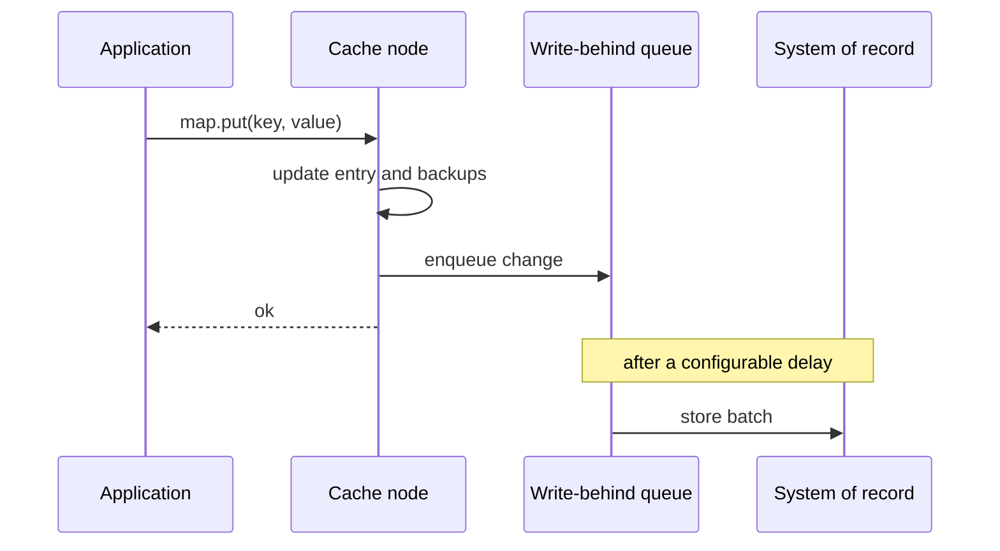

[Patterns](../patterns.md) › [Caching patterns](README.md) › [Access patterns](README.md#access-patterns)

# IP-4 Write-Behind

**Intent.** Writes complete in memory and reach the store asynchronously.

**Context.** Write latency is on the critical path, and the store can tolerate being updated a little later.

**Problem.** How do you take the store's latency off the write path and still persist the latest state of every entry?

**Forces.**
- Low write latency versus a window in which the store lags the cache.
- Batching writes reduces load on the store.
- Until it is stored, a change exists only in memory and its backups.

**Solution.** A write updates the in-memory entry and its backups and returns. Changes are queued and written to the store after a configurable delay, usually in batches.

**Structure.**

**Hazelcast mechanics.** `MapStore` with `write-delay-seconds` > 0, plus `write-batch-size` and `write-coalescing`. With coalescing on (the default), only the latest value of each key is stored, so intermediate updates never reach the store; turn it off if every change must be written. The write-behind queue is backed up to backup members. With coalescing off, the total queue size per member, backups included, is bounded by the property `hazelcast.map.write.behind.queue.capacity` (default 50,000), and writes are rejected when it is full. `IMap.flush()` forces queued writes out, for example before a planned shutdown.

**Consequences.**
- (+) Writes run at memory speed; the store sees fewer, larger writes.
- (−) The store is eventually consistent with the cache.
- (−) Losing a member together with all its backups inside the delay window loses the queued writes. Losing one member does not, if `backup-count` is at least 1.
- (−) After a failover, the promoted backup replays its queue, so the store can receive the same entry twice. `store` and `storeAll` must be idempotent.
- (−) If the store stays down, queued changes accumulate in memory (and, with coalescing off, writes to the map eventually fail).

**Related patterns.** [IP-3](ip-03-write-through.md), [IP-26](ip-26-retry-safe-mapstore-batches.md), [IP-27](ip-27-write-behind-loss-budget-and-recovery.md), [STR-6](../streaming-patterns/str-06-durable-maps.md).

---

← [IP-3 Write-Through](ip-03-write-through.md) · [IP-5 Refresh-Ahead](ip-05-refresh-ahead.md) →
