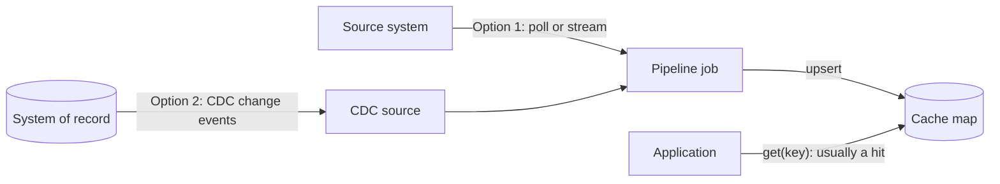

[Patterns](../patterns.md) › [Caching patterns](README.md) › [Access patterns](README.md#access-patterns)

# IP-5 Refresh-Ahead

Also known as: Cache warming, push-based cache.

**Intent.** The cache is updated from the source before clients ask for the data.

> Naming note: in some caching products, refresh-ahead means reloading an entry shortly before it expires. Here it means pushing changes into the cache as they happen at the source.

**Context.** Data is read often, changes at the source, and a miss on the critical path is too expensive.

**Problem.** How do you keep the cache current ahead of demand?

**Forces.**
- Pre-loading avoids miss latency.
- Proactive loading spends resources on data that may never be read.
- The copy always lags the source a little.

**Solution.** Feed changes into the cache proactively, by one of two routes:
1. A stream-processing job retrieves data from the source and writes it to the map.
2. Change data capture (CDC) streams database changes into the map.

**Structure.**

**Hazelcast mechanics.** A pipeline with an IMap sink. For CDC, Hazelcast's Debezium-based CDC sources (Enterprise Edition; Community Edition ships the older "legacy" CDC connector), or an existing CDC tool that publishes to Kafka. `CdcSinks.map` applies change records to an IMap, including deletes, and drops a record whose sequence number is older than the last one it applied for that key.

**Consequences.**
- (+) Clients do not pay miss latency for keys that have been fed in. A miss still happens for keys that have not arrived yet or were evicted, so either size the map to hold the whole data set without eviction, or combine it with [IP-2](ip-02-read-through.md).
- (−) The copy lags the source. Reads that must see the latest write stay on the source.
- (−) CDC is typically at-least-once, so the sink must tolerate replays. Upserts are idempotent only when applied in order: a replayed old change applied after a newer one would regress the entry. Keep per-key ordering (one partition per key), handle delete events, and do not let a second writer update the same keys.

**Related patterns.** [IP-2](ip-02-read-through.md), [ARCH-8](../architecture-patterns/arch-08-change-fed-read-model.md).

---

← [IP-4 Write-Behind](ip-04-write-behind.md) · [IP-6 Near-Cache](ip-06-near-cache.md) →
