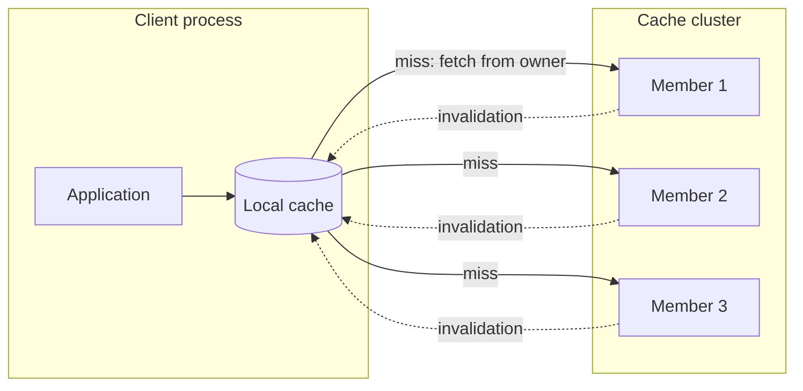

[Patterns](../patterns.md) › [Caching patterns](README.md) › [Access patterns](README.md#access-patterns)

# IP-6 Near-Cache

**Intent.** The client keeps a local copy of entries it reads repeatedly.

**Context.** A client reads the same entries over and over, and even one network hop is too much.

**Problem.** How do you serve repeat reads without a network call?

**Forces.**
- Local reads are the fastest.
- A local copy can be stale.
- Each client spends heap on its copy.

**Solution.** Cache entries inside the client process. The local cache fills as the client fetches entries from the cluster; the cluster sends invalidations when entries change. Invalidations are fire-and-forget and can be lost, so a periodic reconciliation compares what was sent with what was received and drops entries that may have missed an invalidation. A stale value can therefore survive for up to about one reconciliation interval.

**Structure.**

**Hazelcast mechanics.** `NearCacheConfig` on the client (or on members) for a given map, with eviction, TTL/max-idle and `invalidate-on-change` settings. Reconciliation runs every `hazelcast.invalidation.reconciliation.interval.seconds` (default 60); when more than `hazelcast.invalidation.max.tolerated.miss.count` (default 10) invalidations are missing, the affected entries are dropped from the Near Cache. With `in-memory-format: OBJECT`, callers share the cached object; treat values as immutable.

**Consequences.**
- (+) Repeat reads need no network trip.
- (−) Eventually consistent, even for the client that wrote the value to the cluster through another path: use it for immutable or slow-changing values.
- (−) Memory per client grows with the hot set.

**Related patterns.** [IP-2](ip-02-read-through.md), [IP-23](ip-23-miss-coalescing.md), [IP-24](ip-24-freshness-separate-from-ttl.md), [ARCH-7](../architecture-patterns/arch-07-shared-reference-map-with-near-cache.md).

---

← [IP-5 Refresh-Ahead](ip-05-refresh-ahead.md) · [IP-19 Negative Caching](ip-19-negative-caching.md) →
