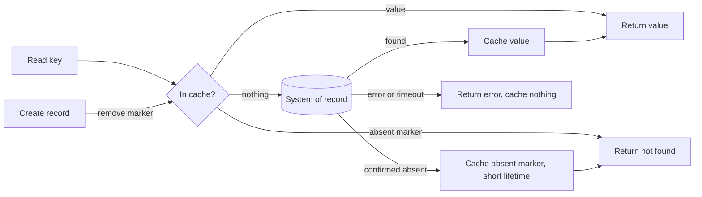

[Patterns](../patterns.md) › [Caching patterns](README.md) › [Invalidation and stale data](README.md#invalidation-and-stale-data)

# IP-19 Negative Caching

Also known as: Miss cache.

**Intent.** Remember for a short time that a key does not exist, so repeated lookups of it stop reaching the store.

**Context.** A cache sits in front of a system of record ([IP-1](ip-01-cache-aside.md), [IP-2](ip-02-read-through.md)). Many reads are for keys that do not exist: deleted records, probes, typos, scanners, or clients polling for a record that is not created yet.

**Problem.** How do you stop repeated misses from hitting the store, without hiding a record once it is created?

**Forces.**
- A lookup of an absent key costs the store as much as a lookup of a present one, and the cache never absorbs it.
- A cached absence becomes wrong the moment the record is created.
- A failed lookup (timeout, error) is not the same as a confirmed absence.
- The space of absent keys is unbounded; a caller generating random keys can fill memory.

**Solution.** When the store confirms that a key is absent, cache a marker meaning "absent, as of now" with a short lifetime. Keep the marker distinct from every real value, and never return it to callers as a value.
1. Cache absence only on a definitive not-found. A timeout or error is never cached as absent.
2. On create, remove the marker for that key, or accept that the record stays invisible for up to the marker's lifetime.
3. Bound the space markers can take, separately from real entries, so a scan of random keys cannot evict real data.

Negative caching is a load-reduction tool. It never makes reads more correct, and its lifetime is the staleness you accept for newly created records.

**Structure.**

**Hazelcast mechanics.**
- A `MapLoader` that returns `null` stores nothing ([IP-2](ip-02-read-through.md)), so read-through alone never caches absence. Either have the loader return a marker object, which every reader must recognise, or keep markers in a separate IMap with its own TTL and size-based eviction.
- Per-entry TTL is set with the TTL overloads of `put` / `set`. TTL resolution is whole seconds: the javadoc says values are rounded up to the next second, but truncation has also been observed in tests, so a marker can expire up to a second early. Do not use sub-second marker lifetimes.
- A Near Cache stores a `null` result and keeps it until an entry with that key is added (or the Near Cache entry expires), which acts as a per-client negative cache ([IP-6](ip-06-near-cache.md)). Like any Near Cache entry it depends on invalidations, which can be lost, so it can hide a new key for up to about one reconciliation interval.

**Consequences.**
- (+) Load from repeated lookups of absent keys drops to about one per key per marker lifetime.
- (−) A newly created record can be invisible for up to the marker lifetime, unless the create path removes the marker.
- (−) Every reader must recognise the marker; a leak shows up as a bogus value.
- (−) Without a separate bound, markers compete with real entries for memory.

**Related patterns.** [IP-1](ip-01-cache-aside.md), [IP-2](ip-02-read-through.md), [IP-6](ip-06-near-cache.md), [IP-20](ip-20-tombstone-with-version-guard.md), [IP-23](ip-23-miss-coalescing.md).

---

← [IP-6 Near-Cache](ip-06-near-cache.md) · [IP-20 Tombstone with Version Guard](ip-20-tombstone-with-version-guard.md) →
