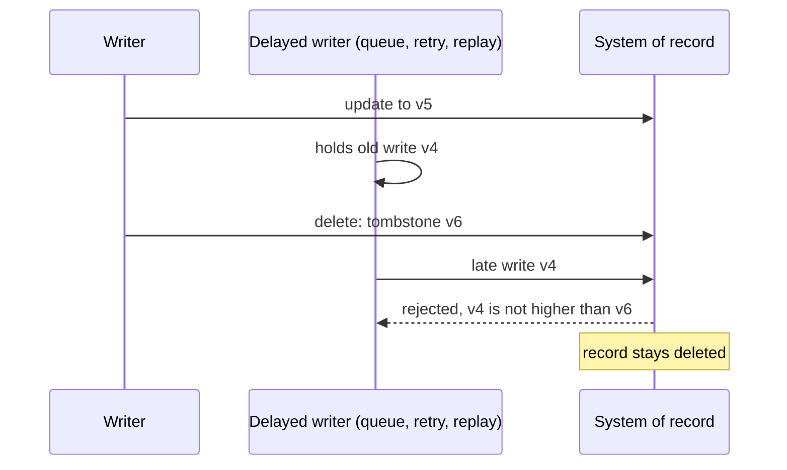

[Patterns](../patterns.md) › [Caching patterns](README.md) › [Invalidation and stale data](README.md#invalidation-and-stale-data)

# IP-20 Tombstone with Version Guard

Also known as: Logical delete, versioned delete.

**Intent.** Record a delete as a versioned tombstone, so that late writes, retries and replays carrying an older version cannot bring the record back.

**Context.** Records are deleted while older copies are still in flight: a write-behind queue, a retried store call, a slow read-through load, a CDC replay, or another cache layer.

**Problem.** How do you make a delete stick when older versions of the record can still arrive afterwards?

**Forces.**
- A physical delete leaves nothing to compare a late write against, so the late write recreates the record.
- Wall clocks on different writers are not a safe order.
- Tombstones cost storage, and every query and unique constraint must take them into account.
- Erasure rules may require the data to be physically removed in the end.

**Solution.**
1. Give every record a version that increases with each change, issued by one ordering authority: the system of record's own row version or sequence, or the position in a single change log. Not a wall-clock timestamp.
2. A delete writes a tombstone: the key, a "deleted" flag and the next version.
3. Every write to the store and every publish to the cache applies only if its version is higher than the current one, tombstones included. Equal or lower versions are discarded.
4. Readers treat a tombstone as absent.
5. Purge a tombstone only after the longest time an older version can still arrive (maximum queue age, retry window, replay window), and physically delete the data then if erasure requires it.

**Structure.**

**Hazelcast mechanics.**
- In the system of record, `MapStore.store` / `storeAll` perform a conditional upsert that applies only when the incoming version is higher; `delete` writes the tombstone. See [IP-26](ip-26-retry-safe-mapstore-batches.md) for retries.
- In the cache, apply versioned updates with an `EntryProcessor`, which compares and writes atomically on the key's partition thread. Keep the tombstone in the IMap until the purge time, or remove the entry and rely on the store's guard.
- A `MapLoader` that finds a tombstone returns `null` (absent) or a tombstone marker, never the deleted data.
- With logical deletes, a CDC feed reports an UPDATE, not a DELETE; the consumer must turn tombstones into removals ([IP-5](ip-05-refresh-ahead.md)).
- After a split-brain, IMap merge policies such as `LatestUpdateMergePolicy` compare update times, not your version; use a custom merge policy that keeps the higher version.

**Consequences.**
- (+) Deletes survive retries, replays and slow loads.
- (+) The same version guard also stops stale updates, not only stale resurrections.
- (−) Storage grows until tombstones are purged; queries, indexes and unique constraints must exclude them.
- (−) Purging too early reopens the window; purging late costs space and may conflict with erasure deadlines.

**Related patterns.** [IP-4](ip-04-write-behind.md), [IP-5](ip-05-refresh-ahead.md), [IP-19](ip-19-negative-caching.md), [IP-22](ip-22-stale-fill-prevention-with-load-tokens.md), [IP-26](ip-26-retry-safe-mapstore-batches.md).

---

← [IP-19 Negative Caching](ip-19-negative-caching.md) · [IP-21 Query-Result Cache with Generation-Based Invalidation](ip-21-query-result-cache-with-generation-invalidation.md) →
