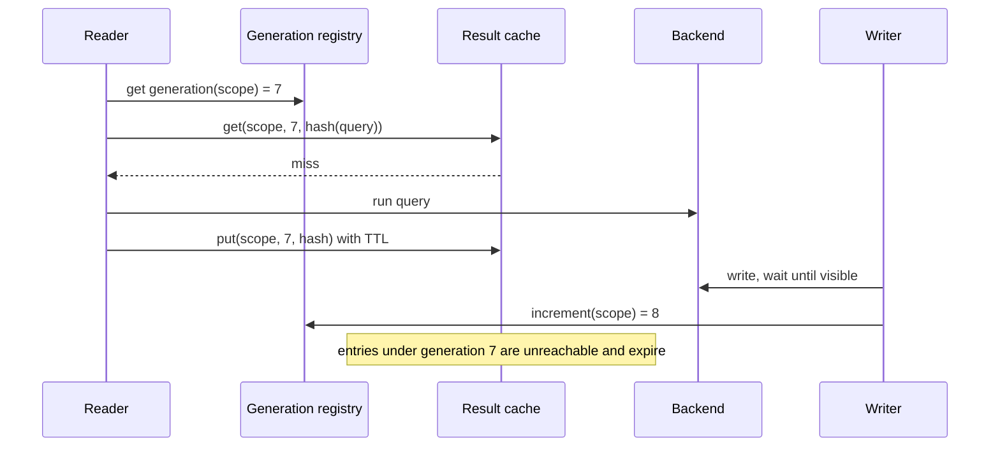

[Patterns](../patterns.md) › [Caching patterns](README.md) › [Invalidation and stale data](README.md#invalidation-and-stale-data)

# IP-21 Query-Result Cache with Generation-Based Invalidation

Also known as: Scope generations, namespace versioning.

**Intent.** Cache the results of queries, and invalidate every result a write may have affected in one step, by moving the affected scope to a new generation.

**Context.** Expensive queries (search, filters, reports, aggregations) repeat often. A single write can change the result of many cached queries, and there is no practical way to list which ones.

**Problem.** How do you invalidate every cached result that a write may affect, without tracking the queries that depend on each record?

**Forces.**
- Tracking which queries depend on which records is impractical; flushing the whole cache on every write is too coarse.
- Queries that mean the same thing can be written differently and should share one entry.
- Some backends make a write visible to queries only after a delay (a search index refresh, a replica lag).
- The generation counter becomes shared state that every reader consults.

**Solution.**
1. Define scopes: the units a write can affect, such as a tenant, a dataset or an index. Keep a current generation number per scope.
2. Build the cache key from scope, current generation and a hash of the canonical query. Canonicalise first: fixed field order, explicit defaults, normalised whitespace and case, paging, and anything that changes what the caller may see (permissions, locale, result format).
3. Read: get the scope's generation, build the key, look it up; on a miss, run the query and cache the result with a TTL.
4. Write: once the write is visible to queries in the backend, increment the generation of every scope it touches. Entries under the old generation become unreachable and expire by TTL.
5. Cache either the full response or only the matching record IDs, which are then fetched (and can be cached) individually.

Increment only after the write is visible. If the generation moves first, a query that runs before the write is visible caches the old result under the new generation.

**Structure.**

**Hazelcast mechanics.**
- Generation registry: an IMap of scope to counter, incremented with an `EntryProcessor` (atomic per key); or CP `IAtomicLong` per scope, or a `CPMap` (Enterprise Edition), when the generation must never go backwards.
- With an AP registry, a split-brain lets both sides move generations independently, and the merge policy decides which survives; if a lower generation wins, stale results become reachable again. Use a merge policy that keeps the higher value, or CP.
- Result cache: an IMap with TTL and size-based eviction, so unreachable generations age out.
- Do not put a Near Cache on the registry unless the staleness of a generation read is acceptable: a stale generation means stale results.

**Consequences.**
- (+) One counter update invalidates any number of cached queries.
- (+) No dependency tracking; equivalent queries share entries once canonicalised.
- (−) Coarse: every result in the scope is invalidated, including those the write did not affect. Narrower scopes cost more increments per write.
- (−) Each read costs one extra lookup for the generation.
- (−) Correctness depends on canonicalisation and on waiting for backend visibility.
- (−) Memory holds unreachable entries until their TTL ends.

**Related patterns.** [IP-1](ip-01-cache-aside.md), [IP-22](ip-22-stale-fill-prevention-with-load-tokens.md), [IP-23](ip-23-miss-coalescing.md), [IP-24](ip-24-freshness-separate-from-ttl.md).

---

← [IP-20 Tombstone with Version Guard](ip-20-tombstone-with-version-guard.md) · [IP-22 Stale-Fill Prevention with Load Tokens](ip-22-stale-fill-prevention-with-load-tokens.md) →
