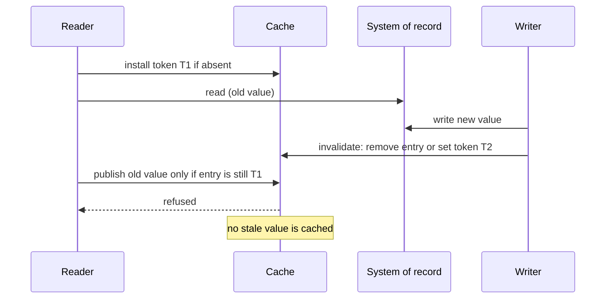

[Patterns](../patterns.md) › [Caching patterns](README.md) › [Invalidation and stale data](README.md#invalidation-and-stale-data)

# IP-22 Stale-Fill Prevention with Load Tokens

**Intent.** Make sure a slow load cannot put back a value that an invalidation has already replaced.

**Context.** Cache-aside ([IP-1](ip-01-cache-aside.md)): a reader misses, reads the store, then fills the cache. Meanwhile a writer updates the store and invalidates the entry. If the reader's fill lands after the invalidation, the cache holds the old value until it expires.

**Problem.** How do you stop a late fill from undoing an invalidation, without locking the key for the duration of the load?

**Forces.**
- Loads run outside the cache and can take a long time.
- Invalidation must stay cheap and never wait for readers.
- A lock held across the load is costly, and a crashed loader must not block the key.

**Solution.**
1. On a miss, the reader installs a unique load token for the key, only if the key is empty, and remembers it. A token has a short lifetime.
2. The reader loads from the store.
3. The reader publishes the value only if the key still holds its own token (compare-and-set). Otherwise it returns the value to its caller without caching it.
4. An invalidation, made after the store write commits, removes the entry or replaces it with a fresh token. Either way the late reader's compare-and-set fails.
5. Readers that find someone else's token treat it as a miss: load without caching, or wait for the loader ([IP-23](ip-23-miss-coalescing.md)).

Where the store provides versions, publishing only when the version is higher than the cached one ([IP-20](ip-20-tombstone-with-version-guard.md)) achieves the same without tokens.

**Structure.**

**Hazelcast mechanics.**
- Install with `putIfAbsent(key, token, ttl, unit)`; publish with `replace(key, token, value)`, which succeeds only if the current value equals the token, or with an `EntryProcessor` that checks the token. Invalidate with `delete` or `set(key, newToken, ttl, unit)`.
- Tokens must be distinguishable from real values, and the token TTL bounds how long a crashed loader can hold the key.
- The IMap is AP: during a split-brain, or after the loss of a key's owner and all its backups, a token can be lost and the race reappears. The pattern reduces stale fills in normal operation; it is not a linearizable guarantee.

**Consequences.**
- (+) Closes the read-invalidate race of cache-aside in normal operation.
- (+) No lock is held during the load.
- (−) Two extra cache operations per miss.
- (−) Every reader must recognise tokens.
- (−) Concurrent readers of a key whose token is held either load uncached or wait.

**Related patterns.** [IP-1](ip-01-cache-aside.md), [IP-20](ip-20-tombstone-with-version-guard.md), [IP-21](ip-21-query-result-cache-with-generation-invalidation.md), [IP-23](ip-23-miss-coalescing.md).

---

← [IP-21 Query-Result Cache with Generation-Based Invalidation](ip-21-query-result-cache-with-generation-invalidation.md) · [IP-23 Miss Coalescing](ip-23-miss-coalescing.md) →
