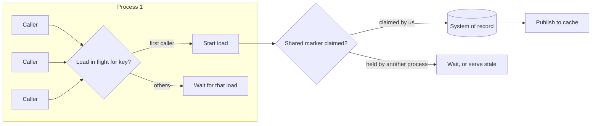

[Patterns](../patterns.md) › [Caching patterns](README.md) › [Load and freshness](README.md#load-and-freshness)

# IP-23 Miss Coalescing

Also known as: Single-flight, request collapsing, stampede protection.

**Intent.** When many callers miss on the same key at the same time, load it from the store once and share the result.

**Context.** A hot key expires or is evicted, or the cache starts cold. Every concurrent request for that key misses at once and goes to the store.

**Problem.** How do you collapse concurrent loads of the same key into one?

**Forces.**
- A burst of identical loads can overload the store exactly when the cache is least able to help.
- Collapsing within one process is cheap; across processes it needs shared state and a round trip.
- Waiting callers add latency, and if the one loader fails or stalls, every waiter is affected.

**Solution.**
1. **Within a process:** keep one in-flight load per key. The first caller starts it; later callers wait for its result. Remove the entry when the load completes or fails, so failures are not cached.
2. **Across processes (optional):** claim ownership of a key's load with an expiring marker in the shared cache. The owner loads and publishes; others wait briefly, poll, or serve a stale value if freshness rules allow ([IP-24](ip-24-freshness-separate-from-ttl.md)). The marker's lifetime bounds how long a failed owner blocks others.
3. Put a timeout on waiting. On timeout, a waiter loads on its own rather than wait for ever.

The local level gives most of the benefit: N processes each loading once is usually acceptable, where N times the number of concurrent requests is not.

**Structure.**

**Hazelcast mechanics.**
- Local single-flight is application code in the client (a per-key map of in-flight futures).
- Shared ownership: `putIfAbsent(markerKey, ownerId, ttl, unit)` on an IMap; the owner removes the marker after publishing. This is best effort, because the IMap is AP and a marker can be lost or claimed twice after a split-brain or the loss of its owner member and backups. It combines naturally with load tokens ([IP-22](ip-22-stale-fill-prevention-with-load-tokens.md)).
- The client Near Cache does not merge concurrent misses for a key: each concurrent `get` still goes to the cluster.
- Avoid a `FencedLock` per key for this; it is heavyweight for a load-reduction concern.

**Consequences.**
- (+) Store load during expiry bursts and cold starts falls to about one load per key per process (or per cluster, with shared ownership).
- (−) Waiters pay the loader's latency, and a slow loader slows everyone waiting.
- (−) Shared ownership adds a round trip and a failure mode; its marker lifetime must exceed a normal load time.

**Related patterns.** [IP-1](ip-01-cache-aside.md), [IP-2](ip-02-read-through.md), [IP-19](ip-19-negative-caching.md), [IP-22](ip-22-stale-fill-prevention-with-load-tokens.md), [IP-24](ip-24-freshness-separate-from-ttl.md).

---

← [IP-22 Stale-Fill Prevention with Load Tokens](ip-22-stale-fill-prevention-with-load-tokens.md) · [IP-24 Freshness Separate from TTL](ip-24-freshness-separate-from-ttl.md) →
