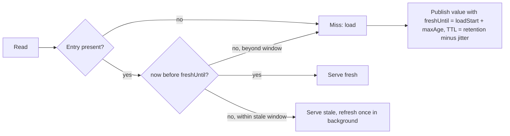

[Patterns](../patterns.md) › [Caching patterns](README.md) › [Load and freshness](README.md#load-and-freshness)

# IP-24 Freshness Separate from TTL

Also known as: Freshness deadline, soft and hard expiry.

**Intent.** Decide whether a cached value is fresh enough from information stored with the value, and use the cache's TTL only to control how long entries stay in memory.

**Context.** Cached values have a freshness requirement, such as "no older than 30 seconds". The obvious implementation sets the cache TTL to that limit.

**Problem.** Why is TTL not a freshness guarantee, and what should decide freshness instead?

**Forces.**
- TTL counts from when the entry was written to the cache, not from when the data was read at the source; the load time, queueing and replays come on top.
- An update to the entry can restart its TTL.
- Max-idle extends an entry's life every time it is read, so it bounds nothing about freshness.
- Entries loaded together expire together, which creates load bursts.
- Serving a slightly stale value is often better than failing, but only within an explicit limit.

**Solution.**
1. Store a freshness deadline with each value, computed from when the load started (or from a timestamp supplied by the source): `freshUntil = loadStart + maxAge`.
2. On read, compare the deadline with the current time:
   - fresh: serve it;
   - stale but within an agreed stale-serve window: serve it and trigger one refresh ([IP-23](ip-23-miss-coalescing.md));
   - beyond the window: treat it as a miss.
3. Set the cache TTL to the retention you want, at least `maxAge` plus the stale-serve window, and spread it with random downward jitter so entries do not all expire at once.
4. Do not use max-idle as a freshness control.

**Structure.**

**Hazelcast mechanics.**
- Store the deadline in the value (or a wrapper). An entry's creation and last-update times (`EntryView`) record cache writes, not source reads, so they cannot stand in for it.
- Retention with map-level `time-to-live-seconds` or per-entry TTL on `put` / `set`, with whole-second resolution. `max-idle-seconds` resets on each access.
- With Persistence enabled, do not count on TTL timing surviving a restart; the deadline in the value does.
- Refresh by reloading through the application, or with `IMap.loadAll(keys, true)` for read-through maps, which replaces existing values.

**Consequences.**
- (+) Freshness is defined by data age, independent of cache mechanics, and is visible in every value.
- (+) Explicit stale-while-refresh behaviour instead of accidental staleness.
- (+) Jitter spreads expiry load.
- (−) Values carry extra metadata and every reader must check it.
- (−) Clock skew between loaders and readers shifts the deadline; keep clocks synchronised or compare on one side.

**Related patterns.** [IP-1](ip-01-cache-aside.md), [IP-2](ip-02-read-through.md), [IP-6](ip-06-near-cache.md), [IP-21](ip-21-query-result-cache-with-generation-invalidation.md), [IP-23](ip-23-miss-coalescing.md).

---

← [IP-23 Miss Coalescing](ip-23-miss-coalescing.md) · [IP-25 Selective Warm-Up](ip-25-selective-warm-up.md) →
