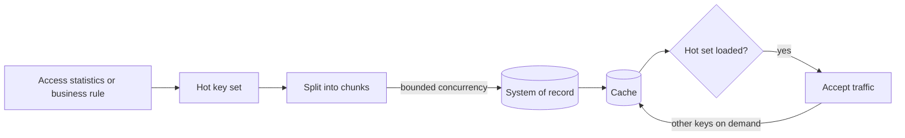

[Patterns](../patterns.md) › [Caching patterns](README.md) › [Load and freshness](README.md#load-and-freshness)

# IP-25 Selective Warm-Up

Also known as: Hot-set preload, load shaping.

**Intent.** Preload only the keys that will be read soon, at a controlled rate, instead of loading everything or nothing.

**Context.** A cache starts empty after a deployment, a restart or a failover. Loading the whole data set takes too long or overloads the store; loading nothing makes the first traffic slow and causes a burst of misses.

**Problem.** How do you get a cold cache useful quickly without overloading the store?

**Forces.**
- A full preload delays readiness and competes with live traffic for the store.
- No preload sends every early request to the store at once.
- The hot set changes over time and has to be estimated.
- Loading on several nodes at once multiplies the load on the store.

**Solution.**
1. Choose a bounded hot set: from recent access statistics, recent activity, or business rules (today's open orders, active sessions).
2. Load it in chunks, with a cap on concurrent store connections, staggered across nodes and callers.
3. Stream keys and values from the store rather than materialising the whole list in memory.
4. Declare readiness when the hot set is loaded, not the whole data set; the rest loads on demand ([IP-2](ip-02-read-through.md)) with miss coalescing ([IP-23](ip-23-miss-coalescing.md)).
5. Measure the hit rate after warm-up and adjust the hot-set rule.

**Structure.**

**Hazelcast mechanics.**
- `MapLoader.loadAllKeys` may deliberately return only the hot set. Read the keys through a streaming cursor so memory stays proportional to the fetch size.
- `initial-load-mode: LAZY` (default) defers the initial load until the map is first used; it still loads every key `loadAllKeys` returns, it is not per-key loading. `EAGER` loads when the map is created.
- Warming from a client with `IMap.loadAll(keys, replaceExistingValues)` can return before the values are in memory, so queries and `executeOnEntries` right after it may see partial data. `getAll(keys)` in chunks returns only once the entries are loaded.
- MapStore calls run on an offload executor by default (`hz:map-store-offloadable`). Size it and the store's connection pool together, so warm-up cannot exhaust the pool that live misses also need.

**Consequences.**
- (+) Fast readiness with a high hit rate for the traffic that matters.
- (+) Store load during warm-up is bounded and predictable.
- (−) The hot-set rule has to be maintained; a wrong rule gives a fast start and a poor hit rate.
- (−) Keys outside the hot set still pay first-read latency.

**Related patterns.** [IP-2](ip-02-read-through.md), [IP-5](ip-05-refresh-ahead.md), [IP-23](ip-23-miss-coalescing.md).

---

← [IP-24 Freshness Separate from TTL](ip-24-freshness-separate-from-ttl.md) · [IP-26 Retry-Safe MapStore Batches](ip-26-retry-safe-mapstore-batches.md) →
