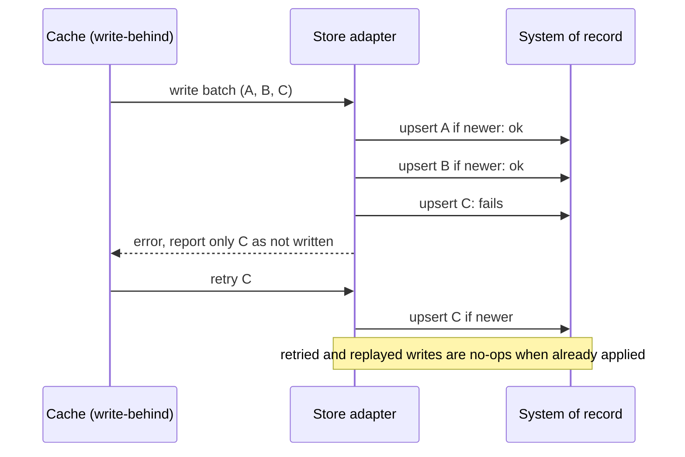

[Patterns](../patterns.md) › [Caching patterns](README.md) › [Persistence safety](README.md#persistence-safety)

# IP-26 Retry-Safe MapStore Batches

Also known as: Idempotent store, at-least-once persistence.

**Intent.** Make every write from the cache to the store correct when it is repeated, and when a batch fails part-way through.

**Context.** The cache persists changes to a system of record, write-through ([IP-3](ip-03-write-through.md)) or write-behind ([IP-4](ip-04-write-behind.md)). Writes reach the store at least once: after errors they are retried, after a failover they are replayed, and a commit can succeed while its acknowledgement is lost.

**Problem.** How do you persist batches so that retries and partial failures never corrupt or duplicate data?

**Forces.**
- Repeated writes are normal operation, not an edge case.
- A batch can fail after some of its entries were committed.
- Reporting a whole batch as failed causes committed entries to be written again.
- One transaction per batch is simple to reason about but holds locks longer and fails as a unit; one per entry is slower.
- An entry that can never be written (a poison entry) must not block the rest.

**Solution.**
1. Make each write an idempotent upsert, guarded by the record's version so an older write never overwrites a newer one ([IP-20](ip-20-tombstone-with-version-guard.md)).
2. Make deletes tolerate a missing record.
3. Choose the transaction boundary on purpose:
   - one transaction per batch: on failure nothing is committed and the whole batch can be retried safely;
   - smaller transactions: on failure, report exactly which entries were committed, so only the rest are retried.
4. Treat "committed but the acknowledgement was lost" as a normal case: the retry lands on an idempotent upsert and changes nothing.
5. After a bounded number of attempts, move a failing entry to a quarantine (dead-letter) store with its error, alert on it, and let the rest proceed ([IP-27](ip-27-write-behind-loss-budget-and-recovery.md)).

**Structure.**

**Hazelcast mechanics.**
- `MapStore.storeAll(Map)`: if it throws, Hazelcast tries the remaining entries one by one with `store()`, and entries the implementation removed from the map are not passed again. So remove each entry from the map as soon as it is committed. `deleteAll(Collection)` works the same way: remove keys from the collection as they are deleted.
- Write-through calls `store` synchronously and propagates its exception to the caller; write-behind uses `storeAll` for batches.
- Keep the version inside the value so the adapter can apply the guard without reading the store first.
- How many times write-behind retries a failing entry, and what happens after that, is not a documented contract; do not rely on it for poison handling, quarantine in the adapter instead.

**Consequences.**
- (+) Retries, replays and lost acknowledgements are harmless.
- (+) A partial failure retries only what failed.
- (+) Poison entries are isolated instead of blocking the queue.
- (−) The store needs a version column or equivalent, and a conditional upsert.
- (−) The quarantine needs an owner, monitoring and a replay procedure.

**Related patterns.** [IP-3](ip-03-write-through.md), [IP-4](ip-04-write-behind.md), [IP-20](ip-20-tombstone-with-version-guard.md), [IP-27](ip-27-write-behind-loss-budget-and-recovery.md), [IP-12](../streaming-patterns/ip-12-durable-maps.md).

---

← [IP-25 Selective Warm-Up](ip-25-selective-warm-up.md) · [IP-27 Write-Behind Loss Budget and Recovery](ip-27-write-behind-loss-budget-and-recovery.md) →
