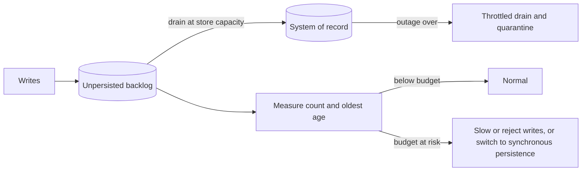

[Patterns](../patterns.md) › [Caching patterns](README.md) › [Persistence safety](README.md#persistence-safety)

# IP-27 Write-Behind Loss Budget and Recovery

**Intent.** Run write-behind against an explicit budget for how much unpersisted data you can afford to lose and how fast you must recover, instead of treating the write delay as that budget.

**Context.** A system uses write-behind ([IP-4](ip-04-write-behind.md)) in production. The configured write delay is often read as "we can lose at most that many seconds of writes".

**Problem.** How much data is actually at risk at any moment, and how do you keep it within what the business accepts, during normal load, store outages and recovery?

**Forces.**
- The write delay is a schedule, not a bound. When changes arrive faster than the store absorbs them, the backlog and the age of the oldest unpersisted change grow without limit.
- A store outage stops draining entirely, while writes keep succeeding in memory.
- Queued changes survive the loss of a member while backups survive; they are lost only with the owner and all its backups, or with the whole cluster.
- When the store comes back, the backlog drains in a surge that can overload it again.
- Different data classes tolerate very different losses.

**Solution.**
1. **Set the budget per data class:** the maximum unpersisted changes (count, age, or business value) you can lose, and the maximum recovery time. Data that can lose nothing does not use write-behind.
2. **Model it:** backlog grows at (arrival rate − drain rate). The oldest change is roughly the write delay plus backlog ÷ drain rate. Size the store's drain capacity for peak arrival, not average.
3. **Measure it continuously:** unpersisted entry count and age of the oldest unpersisted change, per member. Alert well before the budget is reached.
4. **Act when the budget is at risk:** shed or slow incoming writes, switch the data class to synchronous persistence, or reject writes, rather than let the budget be exceeded silently.
5. **Recover deliberately:** drain the backlog at a throttled rate the store can sustain; quarantine entries that keep failing ([IP-26](ip-26-retry-safe-mapstore-batches.md)); after a loss beyond the budget, rebuild from an upstream durable log or from the system of record.

**Structure.**

**Hazelcast mechanics.**
- Configuration: `write-delay-seconds`, `write-batch-size`, `write-coalescing`, and `backup-count` of at least 1 so queued changes survive a single member loss.
- With coalescing off, the write-behind queue per member is bounded by `hazelcast.map.write.behind.queue.capacity` (default 50,000, backups included); a full queue rejects writes, which is a built-in form of step 4. With coalescing on, the queue holds at most one change per key.
- `LocalMapStats.getDirtyEntryCount()` gives the number of entries a member owns that are not yet persisted. The age of the oldest change is not exposed directly; record a write timestamp in the value if you need it.
- `IMap.flush()` before a planned shutdown persists the backlog.
- Throttle recovery with the batch size and the size of the MapStore offload executor relative to the store's connection pool.

**Consequences.**
- (+) The real exposure is known, measured and alerted on.
- (+) Overload and outages degrade in a chosen way rather than by silent growth of the backlog.
- (+) Recovery does not knock the store over a second time.
- (−) Needs monitoring, a load-shedding path and a rebuild procedure, all of which must be tested.
- (−) The budget can force synchronous persistence for some data, giving up write-behind's latency benefit there.

**Related patterns.** [IP-3](ip-03-write-through.md), [IP-4](ip-04-write-behind.md), [IP-26](ip-26-retry-safe-mapstore-batches.md), [ARCH-6](../architecture-patterns/arch-06-site-strategy-per-data-class.md).

---

← [IP-26 Retry-Safe MapStore Batches](ip-26-retry-safe-mapstore-batches.md)
