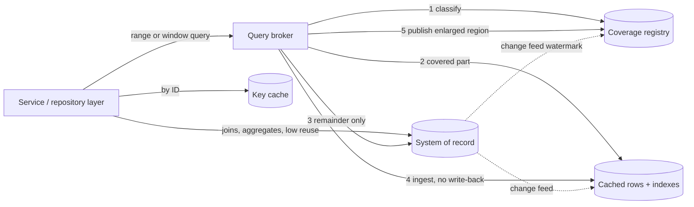

[Patterns](../patterns.md) › [Solution patterns](README.md)

# SOL-1 Semantic Relational Cache

Also known as: Semantic dataset cache, coverage-aware query cache, answering queries using cached views. Not to be confused with "semantic caching" of LLM responses by embedding similarity, which is unrelated.

**Intent.** Answer whole predicate queries ("every order with value above X") from the cache when the cache can prove it holds every matching row, and send only the missing part of the question to the database otherwise.

**Context.** A relational database serves repeated, overlapping filter queries: recent time windows, value or quantity ranges, a customer's history, a warehouse queue. The goal is to take that read work off the database, for capacity, cost or licensing reasons. Rows are already cached by key, but the database still runs every filter.

**Problem.** A key-value cache knows which rows it holds, not which rows exist. How can it answer a predicate query without asking the database, and stay correct?

**Forces.**
- An object cache answers "do I have key 42?". A dataset query asks "do I have **every** row that matches?". Having many rows does not prove having all of them, and an empty result from the cache proves nothing on its own.
- An index on the cache speeds up searching what is present; it cannot reveal what is missing.
- Neighbouring queries overlap heavily, so a complete region can answer many different requests, not only repeats of the same one.
- Memory is finite. Admitting every fetched range grows the cache without bound; refusing them all gives no reuse.
- Rows in the source change. A region that was complete yesterday may not be complete today.
- Proving that one query is contained in another is easy for simple shapes (a range inside a range) and hard in general: for conjunctive queries it is NP-complete, and with negation or set difference it is undecidable.

**Solution.** Cache rows together with a description of the regions they cover completely, and reason about the query against that description.

1. **Coverage registry.** For each cached table, record the predicate regions that are known complete as of a source version, for example "value > 100, as of snapshot S". A region is a correctness commitment, not a hit-rate hint. An empty region is valid and useful: it is verified negative knowledge.
2. **Classify each query.** Check whether the query's region is contained in covered regions. The outcome is a **full hit** (answer locally), a **partial hit** (answer the covered part locally and compute the exact **remainder**, for example "50 < value ≤ 100"), or a **miss**.
3. **Fetch only the remainder.** Send the remainder to the source. The covered part and the remainder are disjoint, so the answer is their union without de-duplication, which keeps row multiplicity right.
4. **Ingest, then publish.** Put the fetched rows into the cache without writing them back to the source. Only after every row is in place, publish the enlarged region. If the fetch or ingest fails, publish nothing; the answer is still served from what was fetched.
5. **Admit within a budget.** Measure what each region costs in memory (rows, indexes, registry, backups) and enforce a hard cap. When the cap is reached, either serve the remainder without keeping it, or evict a whole region (withdrawing its coverage first) to make room, by an explicit policy that weighs database work avoided against memory and refresh cost.
6. **Preload by verified regions.** Warm the cache with candidate regions, verify each one against the source (row count, keys, multiplicity), and keep only those that verify and fit the budget.
7. **Keep it fresh.** For a mutable source, feed changes into the cached rows and track how far changes have been applied (a watermark). A region is valid only up to the version the change feed has reached; on a change the region cannot absorb, narrow or withdraw it.
8. **Route at the service boundary.** Send only the query families that fit to the semantic cache: overlapping ranges and windows. Send lookups by ID to a key cache, and leave joins, aggregates and one-off reports to the database or an analytics store. Count all traffic when measuring offload.

**Structure.**

**Composed of.**
- [IP-1 Cache-Aside](../caching-patterns/ip-01-cache-aside.md): the broker, not the cache, decides what to load. Read-through by key ([IP-2](../caching-patterns/ip-02-read-through.md)) cannot help, because predicate queries over the cache never trigger a load.
- [IP-19 Negative Caching](../caching-patterns/ip-19-negative-caching.md), generalised: a verified empty region is remembered absence for a whole range, not one key.
- [IP-21 Query-Result Cache with Generation-Based Invalidation](../caching-patterns/ip-21-query-result-cache-with-generation-invalidation.md): the simpler alternative when queries repeat exactly. SOL-1 adds reuse across different, overlapping queries, at the cost of containment logic.
- [IP-22 Stale-Fill Prevention with Load Tokens](../caching-patterns/ip-22-stale-fill-prevention-with-load-tokens.md): a remainder fetched before a change arrives must not overwrite the newer row or be published as current.
- [IP-23 Miss Coalescing](../caching-patterns/ip-23-miss-coalescing.md): concurrent requests that need the same remainder fetch it once.
- [IP-24 Freshness Separate from TTL](../caching-patterns/ip-24-freshness-separate-from-ttl.md): region validity comes from the source version, never from a timer.
- [IP-25 Selective Warm-Up](../caching-patterns/ip-25-selective-warm-up.md): verified preload of candidate regions within a budget.
- [ARCH-8 Change-Fed Read Model](../architecture-patterns/arch-08-change-fed-read-model.md): keeps cached rows and coverage current for a mutable source.
- [ARCH-4 Compute Near Data](../architecture-patterns/arch-04-compute-near-data.md): the covered part is filtered where the rows live and only results travel.
- [ARCH-1 Operational Data Fabric](../architecture-patterns/arch-01-operational-data-fabric.md): SOL-1 can be one read path inside a wider fabric.

**Hazelcast mechanics.**
- Rows: an IMap per table, with a sorted index on each coverage column; Hazelcast SQL or predicates evaluate the covered part on the members.
- SQL and predicates over an IMap see only entries in memory; they never call the MapLoader. This is why completeness has to be tracked outside the map.
- Ingest: `putTransient` stores fetched rows without calling the MapStore, so the source is not written to. A controlled preload uses a MapLoader whose initial key load returns nothing, so the broker, not the map, decides what is loaded.
- Containment and planning: not a Hazelcast feature. The proof of concept used Apache Calcite to parse and validate SQL against the registered schema; containment for the supported shape (one integer column, lower bound) was the broker's own interval logic, not general materialised-view rewriting.
- Coverage registry: with one broker per table, a single writer serialises expansions and an IMap is enough. With several brokers, registry updates need a linearizable home, such as a `CPMap` or `IAtomicReference` (CP Subsystem, Enterprise Edition, with per-group throughput and size limits; see [ARCH-5](../architecture-patterns/arch-05-platform-level-idempotency.md)).
- Losing rows: register a `MapPartitionLostListener` and withdraw every region touching a partition whose owner and all backups were lost. Do not configure TTL, max-idle or size-based eviction on a covered map; the only way rows may leave is the broker's own coverage-aware eviction.
- Freshness: CDC connectors (Enterprise Edition) feed changes through a pipeline into the row map and advance the watermark.

**Consistency limits.**
- IMap is AP. A covered region is only as complete as the rows behind it. If rows disappear silently (a member and all its backups lost, eviction, expiry, a split-brain merge that keeps the other side's entries), the cache returns a **short answer with no error**. That is the dangerous failure: fail closed by withdrawing coverage whenever row loss is possible, and by treating an unknown state as a miss.
- Rows and coverage are separate entries with no atomic update across them. Order the steps so readers never see a region without its rows: ingest rows before publishing coverage; withdraw coverage before evicting rows. A reader that classified a query before a withdrawal can still read a shrinking region; serialise expansion and eviction per table, or version regions and re-check the version after the query.
- A query over an IMap is not a point-in-time snapshot across partitions; concurrent updates may or may not be visible. With a change feed, an answer reflects the source up to the watermark, not a single transaction.
- The completeness proof holds against one source version. The proof of concept assumed an immutable source; mutable data needs ordered changes per key, correct handling of deletes, and a region version no newer than the applied watermark.
- Containment must be decided exactly. For any query shape whose containment cannot be proven, route to the source; never approximate.

**Consequences.**
- (+) The database no longer runs covered queries at all: both finding the matching rows and returning them move to the cache. Only remainders reach the source.
- (+) Reuse across different, overlapping queries, not only exact repeats.
- (+) Verified empty regions answer "nothing matches" without a database call.
- (−) Offload depends on how much of the real traffic fits the supported shapes. In the proof of concept (PostgreSQL, 1,000-query workloads, 4 MiB per-table cap, measured 2026-09-11), a workload built for locality cut rows transferred from the database by 91.87% for Orders, while a mixed order-service workload where only 20% of requests fit cut them by 4.97%. Measure the whole mix.
- (−) Offload is not a latency win by itself. In the same study, median broker latency was often higher than direct database latency because of planning and execution overhead.
- (−) The memory cap is the economic control: a tighter cap means lower cache cost and more remainder reads. Report the offload curve against the cap, not a single number. Count backups in the cap.
- (−) Fewer database queries do not by themselves reduce database licence or hardware cost; a saving needs a real change in deployed capacity.
- (−) Containment logic, coverage-aware eviction, freshness tracking and loss detection are custom code. Hazelcast provides the storage, querying and change feed, not the semantics.

**When not to use it.** Queries rarely overlap; most traffic is joins or aggregates; the source changes faster than coverage can be maintained; or exact repeats dominate, in which case [IP-21](../caching-patterns/ip-21-query-result-cache-with-generation-invalidation.md) is simpler.

**Related patterns.** [IP-1](../caching-patterns/ip-01-cache-aside.md), [IP-19](../caching-patterns/ip-19-negative-caching.md), [IP-21](../caching-patterns/ip-21-query-result-cache-with-generation-invalidation.md), [IP-22](../caching-patterns/ip-22-stale-fill-prevention-with-load-tokens.md), [IP-23](../caching-patterns/ip-23-miss-coalescing.md), [IP-24](../caching-patterns/ip-24-freshness-separate-from-ttl.md), [IP-25](../caching-patterns/ip-25-selective-warm-up.md), [ARCH-8](../architecture-patterns/arch-08-change-fed-read-model.md), [ARCH-1](../architecture-patterns/arch-01-operational-data-fabric.md), [ARCH-4](../architecture-patterns/arch-04-compute-near-data.md).

**Background.** Dar et al., "Semantic Data Caching and Replacement", VLDB 1996 (regions and remainder queries); Halevy, "Answering Queries Using Views: A Survey", VLDB Journal 2001 (containment); Chandra and Merlin, STOC 1977 (conjunctive query containment).

---

[SOL-2 High-Throughput Tiered Idempotency](sol-02-high-throughput-tiered-idempotency.md) →
