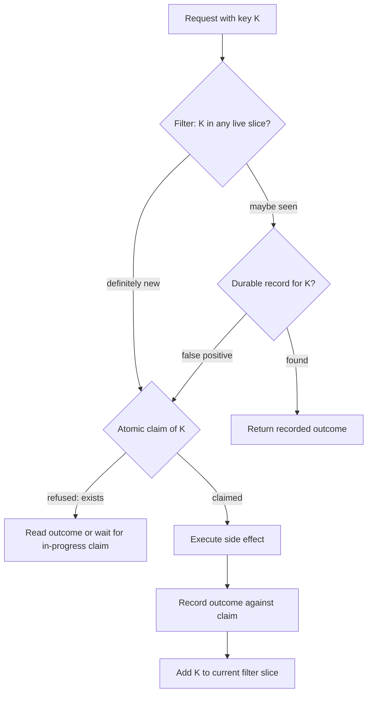

[Patterns](../patterns.md) › [Solution patterns](README.md)

# SOL-2 High-Throughput Tiered Idempotency

Also known as: Negative-attested routing, filter-fronted deduplication.

**Intent.** At high request rates, skip the durable "have we seen this key?" lookup for keys that an in-memory filter proves are new, while an atomic claim, not the filter, keeps duplicates out.

**Context.** A payment, order or event-processing service must not execute the same operation twice, although clients retry, networks drop replies and upstream systems fan out. Every operation carries an idempotency key. The durable record of processed keys is authoritative, but looking it up on every request costs latency and I/O, and almost all keys are new.

**Problem.** How do you keep the duplicate check off the durable store for the common case (a new key) without letting a duplicate through?

**Forces.**
- Most keys are new; duplicates are rare but must never execute twice.
- A durable lookup per request is the cost to avoid, especially when the store is remote, cross-region or uses a costly consensus write for conditional inserts.
- A probabilistic filter is tiny (about 10 bits per key for a 1% false-positive rate) but only one-sided: "definitely new" or "maybe seen".
- A filter cannot delete keys, so it fills up; the duplicate window is bounded in time.
- Two copies of the same request can arrive at the same moment; both see "new".
- The in-memory tier can lose state: a member failure, a cluster restart, a split-brain merge, a skewed clock. Lost state turns "maybe seen" into "definitely new", which is the one answer the filter must never give wrongly.

**Solution.** Split the work into three tiers with different jobs, and never let the fast tier be the last word.

1. **Filter tier (route).** Keep a probabilistic filter of keys completed within the retention window. "Definitely new": skip the pre-check read and go straight to the claim. "Maybe seen": read the durable record; if it is there, return the recorded outcome; if not, it was a false positive, so continue to the claim.
2. **Claim tier (exclude).** Before any side effect, claim the key atomically: a conditional insert of an "in progress" record, which fails if the key exists. The claim is the real duplicate check, and it also catches every duplicate the filter missed. Put the claim where it is authoritative: a unique-key conditional insert in the durable store, or a strongly consistent claim store as in [ARCH-5](../architecture-patterns/arch-05-platform-level-idempotency.md) backed by the durable record.
3. **Durable tier (record).** Execute, then record the outcome against the claim ("done", with the result), and only then add the key to the filter. A crash between recording and the filter update is harmless: the next attempt misses the filter, the claim fails, and the recorded outcome is returned.

Rules that keep the tiers correct:
- **Time-sliced filter.** Divide the retention window into slices; write only to the current slice, read the union of all live slices, and drop a whole slice when it ages out. The combined false-positive rate is about the number of slices times the per-slice rate, so size each slice for a fraction of the target (12 slices at 0.1% each give about 1.2%).
- **Roll slices on time or fill, whichever comes first.** False positives rise steeply past the rated fill: a filter sized for 1% at its rated load gives about 16% at double the load, which can push most of the extra traffic onto the durable store during a spike.
- **Insert at completion time.** Add a key to the slice that is current when the operation finishes, not when it started, and keep the retention window at least the business window plus the longest operation time.
- **Absorb clock skew.** Read one slice beyond each edge of the window, and derive the current slice from one shared clock or epoch, not each caller's wall clock.
- **Keep one key's bits together.** Shard each slice by key so that all of a key's bits fall in one shard, ideally in one CPU cache line. One check then costs one call per slice, not one per bit.
- **Fence side effects, not only writes.** A worker that pauses after claiming can lose its claim and wake up to repeat work. A fencing token checked by the store stops its late write, but not an external call it already made. Make the claim itself the gate: the store refuses a claim or a state change carrying an older token, and the worker checks it still holds the claim before any external side effect.
- **Recover abandoned claims.** A worker that dies leaves an "in progress" record. Expire such claims after a timeout and reconcile them against the side effect's outcome; otherwise the key is blocked forever.
- **Cold start fails safe and throttled.** After the filter is lost, treat every key as "maybe seen" (all traffic reads the durable store), shed or rate-limit load at the edge so the store is not swamped, and rebuild the newest slice first, because most duplicates arrive soon after the original.

**Structure.**

**Composed of.**
- [ARCH-5 Platform-Level Idempotency](../architecture-patterns/arch-05-platform-level-idempotency.md): the claim tier. SOL-2 adds a filter in front to avoid durable reads at high rates.
- [IP-19 Negative Caching](../caching-patterns/ip-19-negative-caching.md), inverted: the filter remembers presence compactly, and its useful answer is the guaranteed negative.
- [IP-25 Selective Warm-Up](../caching-patterns/ip-25-selective-warm-up.md): rebuilding the filter newest slice first, at a controlled rate.
- [ARCH-2 Brownout and Degraded Mode](../architecture-patterns/arch-02-brownout-and-degraded-mode.md) and [IP-14 Backpressure](../streaming-patterns/ip-14-backpressure.md): shedding load while the filter is cold or saturated.
- [ARCH-3 Burst Absorption](../architecture-patterns/arch-03-burst-absorption.md): queue spikes before the claim tier.
- [IP-18 Partitioned Compute](../streaming-patterns/ip-18-partitioned-compute.md): run the filter check where the key's shard lives.
- [IP-17 Processing Guarantee](../streaming-patterns/ip-17-processing-guarantee.md): inside one streaming job, the engine's own guarantee may make this unnecessary.

**Hazelcast mechanics.**
- Filter: an IMap per slice of small bit-array shards, keyed so that one key's bits land in one shard (partition-aware keys). Set bits with an EntryProcessor on the shard's partition owner; check membership with a read-only, offloadable EntryProcessor or a partition-routed task, so one check is one call per slice. Keep shards small: with BINARY (the default) or NATIVE in-memory format an EntryProcessor deserialises and reserialises the whole value, so a single-bit update copies the shard; OBJECT format avoids the copy on the owner at the cost of on-heap objects.
- Slice expiry: drop or expire a slice's shards as a unit (for example by TTL set to the window plus one slice, or by destroying the slice's map). In Hazelcast an update resets an entry's TTL, so the clock starts from the last write to the shard.
- Backups: at least one synchronous backup. On a split-brain merge the bit arrays must be merged by bitwise OR, which needs a custom merge policy; the built-in policies keep one side's value and drop the other side's bits.
- Near Cache on the filter: avoid, or accept it only because the claim tier catches what it misses; its invalidation is eventual, so a just-added key can read as "new".
- Claim tier on the grid: `CPMap.putIfAbsent` gives a linearizable claim in one Raft commit (CP Subsystem enabled with at least 3 CP members; Enterprise Edition; no TTL, so old claims must be deleted by your code; 100 MB per map by default, at most 2,000 MB, on heap). Each CP group has one Raft leader, so throughput is bounded per group: spread claims over several pre-defined CP groups. A `FencedLock` per idempotency key is a poor fit at this rate: each acquire, release and destroy is a Raft commit, and a lock left undestroyed stays in the CP group's state.
- `FencedLock` ownership is tied to a CP session; a caller that stops heartbeating loses the lock when the session expires (5-minute session time-to-live by default), which is exactly the paused-worker case above.
- An AP claim (`IMap.putIfAbsent` with TTL) is fast but best effort: it can admit a duplicate during a split-brain or after a member and all its backups are lost. Use it only to reduce contention in front of an authoritative claim.

**Consistency limits.**
- The filter lives in an AP IMap. Member loss beyond the backups, a cluster restart, a split-brain merge without OR-merging, an evicted slice or clock skew can all produce false negatives. Every one of them is safe only because a new-looking key still has to win an authoritative claim. **Never skip the claim on a negative.**
- The saving is one durable read per new key, not the durable write. The claim and the outcome record are writes you pay anyway. If the store can do a cheap unique-key insert, a plain "insert, and on conflict read the outcome" with no filter needs no read for new keys either; the filter then mostly adds complexity. It pays off when the authoritative check is expensive, for example a cross-region read or a consensus-based conditional write, or when a claim store sits in front of the durable record.
- A double-checked read of the durable store inside the critical section, as some designs add, re-introduces the very read the filter exists to avoid. Let the atomic claim be the second check instead.
- Idempotency here means effectively-once: each key's side effect happens at most once per successful claim, and retries get the recorded outcome. External side effects that cannot carry or check a token still need their own idempotency.
- A linearizable claim store stops on the minority side of a network split; the durable store's own consistency governs a durable claim.

**Consequences.**
- (+) Durable read traffic for new keys falls to about the filter's false-positive rate.
- (+) Memory grows with rate times window, at roughly 10 to 15 bits per key, not with key or payload size.
- (+) Correctness never depends on the in-memory tier, so it can be rebuilt or lost without admitting duplicates.
- (−) More moving parts than [ARCH-5](../architecture-patterns/arch-05-platform-level-idempotency.md) alone: slice management, sizing, merge policy, cold-start gating, claim recovery.
- (−) Load spikes and cold starts move traffic onto the durable store; the store and the edge must be provisioned or throttled for that, not only for the steady-state false-positive rate.
- (−) Figures such as "under 1% of requests reach the store" hold only at or below the rated fill and with a warm filter.

**When not to use it.** Request rates the durable store handles comfortably; a store with a cheap conditional insert; duplicate windows so long that the filter would be very large; or processing inside one streaming job, where the engine's processing guarantee and keyed state are simpler.

**Related patterns.** [ARCH-5](../architecture-patterns/arch-05-platform-level-idempotency.md), [IP-14](../streaming-patterns/ip-14-backpressure.md), [IP-17](../streaming-patterns/ip-17-processing-guarantee.md), [IP-18](../streaming-patterns/ip-18-partitioned-compute.md), [IP-19](../caching-patterns/ip-19-negative-caching.md), [IP-25](../caching-patterns/ip-25-selective-warm-up.md), [ARCH-2](../architecture-patterns/arch-02-brownout-and-degraded-mode.md), [ARCH-3](../architecture-patterns/arch-03-burst-absorption.md), [SOL-1](sol-01-semantic-relational-cache.md).

**Background.** Bloom, CACM 1970; Kirsch and Mitzenmacher, "Less Hashing, Same Performance", ESA 2006 (two hashes are enough); Putze, Sanders and Singler, "Cache-, Hash- and Space-Efficient Bloom Filters", 2007 (blocked filters); Kleppmann, "How to do distributed locking", 2016 (fencing tokens).

---

← [SOL-1 Semantic Relational Cache](sol-01-semantic-relational-cache.md) · [SOL-3 Read Tier for Ephemeral Clients](sol-03-read-tier-for-ephemeral-clients.md) →
