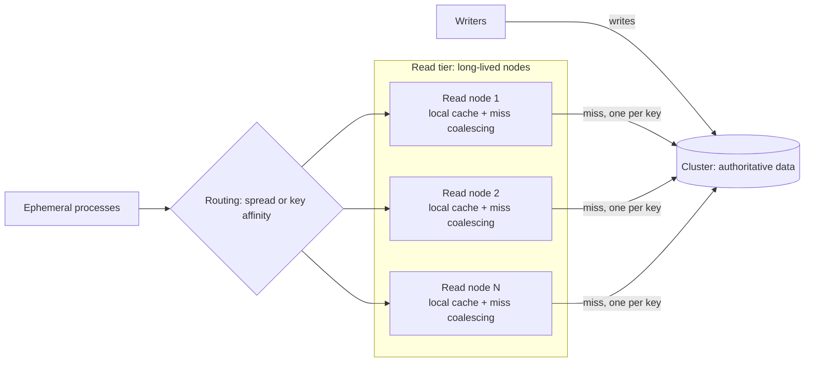

[Patterns](../patterns.md) › [Solution patterns](README.md)

# SOL-3 Read Tier for Ephemeral Clients

Also known as: CQRS-style read scaling for immutable data, caching query tier, read proxy fleet.

**Intent.** Put a fleet of long-lived read nodes between short-lived client processes and the cluster, so that repeated reads of immutable data are answered from the read nodes' caches instead of reaching the cluster again for every new process.

**Context.** Many short-lived processes (batch tasks, serverless functions, per-request workers, calculation jobs) start, read the same immutable data from the cluster, and exit. The data does not change once written; it may be added to and eventually removed. Each process connects to the cluster directly.

**Problem.** A client-side cache only pays off when the same process reads the same key several times. How do you get cache reuse when the processes live too briefly to reuse anything?

**Forces.**
- A local client cache (Near Cache) is lost when the process exits, so each new process reads everything from the cluster again. The cluster serves the same keys over and over, hot partitions saturate, and operation queues grow.
- Connecting to the cluster is itself work: a full client fetches cluster metadata and, by default, connects to every member. Thousands of brief connections cost the cluster as well as the client.
- Immutable data removes the hardest part of caching: a cached value can never be stale, only absent or already deleted.
- An extra tier adds a network hop, a fleet to run, and a new failure point.
- Scaling the cluster only to absorb duplicate reads buys memory and partitions the data set does not need.

**Solution.** Move the long-lived cache out of the ephemeral processes into a tier that lives long enough to reuse it.

1. **Read nodes.** Run a fleet of long-lived read nodes. Each holds one long-lived cluster client with a local cache of the immutable data and exposes a narrow read-only API: get by key, get many keys, check existence. Ephemeral processes call the read tier, never the cluster.
2. **Writes bypass the tier.** Writers keep writing to the cluster directly. Because values never change, the read tier needs no invalidation for updates; it only has to handle removal of data at the end of its life.
3. **Collapse duplicate misses.** On a local miss, let only one request per key go to the cluster at a time; concurrent requests for the same key wait for that one result. This protects the cluster during cold starts, scale-outs and synchronised bursts.
4. **Batch the rest.** For a multi-key read, answer the locally cached keys at once and fetch all missing keys in one batched call.
5. **Remember absence.** Existence checks and reads of keys that do not exist would otherwise always reach the cluster. Cache confirmed absence for a short time, if the data set can gain those keys later, or for longer if it cannot.
6. **Choose the routing deliberately.** How requests reach read nodes decides both cluster load and read-node memory:
   - *Spread routing* (round robin, random, DNS): every node caches the whole hot set. Cluster reads for warm-up are about nodes × distinct keys, and a single hot key is spread across the fleet.
   - *Key-affinity routing* (consistent hashing on the key): each key is cached on one node. Cluster reads are about distinct keys, and memory per node falls with fleet size, but a single hot key lands on one node, and a node loss makes its share of keys cold at once.
   - A common middle ground is key affinity with a small number of replicas for the hottest keys.
7. **Serve bytes, not objects.** Because values are immutable, read nodes can keep them in their serialised form and hand the same bytes to every caller, keeping allocation and garbage collection low. This works only if callers can decode that format.
8. **Fail without stampeding.** If the read tier is unavailable, ephemeral processes must not all fall back to the cluster at once, which would reproduce the original problem at its worst moment. Shed or delay load instead, and warm new read nodes at a controlled rate.
9. **Measure at the boundary.** Track requests, latency, hit ratio, coalesced requests, in-flight misses and cluster calls per read node. The ratio of client requests to cluster calls is the saving.

**Structure.**

**Composed of.**
- [IP-6 Near-Cache](../caching-patterns/ip-06-near-cache.md): the local cache inside each read node, which now lives long enough to be reused.
- [ARCH-7 Shared Reference Map with Near Cache](../architecture-patterns/arch-07-shared-reference-map-with-near-cache.md): the same idea for long-lived services; SOL-3 adds the tier that makes it work for short-lived ones.
- [IP-23 Miss Coalescing](../caching-patterns/ip-23-miss-coalescing.md): one cluster read per missing key at a time.
- [IP-19 Negative Caching](../caching-patterns/ip-19-negative-caching.md): existence checks and missing keys.
- [IP-25 Selective Warm-Up](../caching-patterns/ip-25-selective-warm-up.md): warming new read nodes without a burst on the cluster.
- [ARCH-2 Brownout and Degraded Mode](../architecture-patterns/arch-02-brownout-and-degraded-mode.md) and [ARCH-3 Burst Absorption](../architecture-patterns/arch-03-burst-absorption.md): behaviour when the tier or the cluster is overloaded.
- [ARCH-8 Change-Fed Read Model](../architecture-patterns/arch-08-change-fed-read-model.md): the push alternative, when read nodes should be filled ahead of demand rather than on a miss.

**Hazelcast mechanics.**
- Read nodes: each runs one Hazelcast client with a Near Cache on the immutable map. Near Cache max size and eviction bound each node's memory. The NATIVE (off-heap, High-Density) Near Cache format, which keeps cached values outside the Java heap, is Enterprise Edition; BINARY keeps them serialised on the heap.
- Multi-key reads: `IMap.getAll` on a client with a Near Cache answers cached keys locally and fetches the rest in batches grouped by partition, so the batching in step 4 is largely built in.
- Miss coalescing: do not assume the Near Cache provides it. Its reservation mechanism stops a late fetch from overwriting a newer value, but concurrent misses for the same key can still each reach the cluster. Coalesce in the read node.
- Absent keys: a client Near Cache stores a `null` result from `get` and keeps it until the key is added, and `containsKey` answers from cached entries, including cached nulls; `containsKey` alone does not fill the Near Cache. This covers much of step 5, but the lifetime of cached absence then follows Near Cache invalidation rather than a limit you choose, so add explicit negative caching where that matters ([IP-19](../caching-patterns/ip-19-negative-caching.md)).
- Invalidation: with immutable values there are no update invalidations to lose. Removals (deletes, expiry, eviction on the cluster) still reach Near Caches only eventually: a removed key can be served for up to about one reconciliation interval (see [IP-6](../caching-patterns/ip-06-near-cache.md)).
- Connections: read nodes keep a small, stable number of client connections, instead of every ephemeral process opening its own and loading cluster metadata.
- Alternatives inside Hazelcast: making the read nodes cluster members holding a `ReplicatedMap` gives every node a full copy, pushed rather than pulled, but adds them to the cluster's membership; worth it only for small data sets.

**Consistency limits.**
- The cluster's maps are AP, not strongly consistent. This solution adds no consistency of its own: a read node returns what the cluster returned when the key was first read.
- Immutability is what makes the cache safe. If any value is ever updated in place, read nodes can serve the old value until invalidation reaches them, and for an unbounded time if the read path is not invalidated at all. Treat "immutable" as a contract the writers must keep, and give new values new keys.
- Removed data can still be served for a bounded time after removal. If serving removed data is not acceptable, remove it through a path that also clears the read tier.
- Cached absence is the one value that can become wrong when new keys are added; keep its lifetime short unless keys are never added once a data set is published.

**Consequences.**
- (+) Cluster reads fall from about processes × keys to about read nodes × distinct keys with spread routing, or about distinct keys with key-affinity routing, plus re-reads after eviction.
- (+) The read tier scales out with client concurrency; the cluster is sized for data and writes, not for duplicate reads.
- (+) One place to observe and control read load.
- (−) An extra network hop on every read, compared with a warm Near Cache in a long-lived process; for ephemeral processes the comparison is with a cluster read, which this hop usually beats only when the tier answers from cache.
- (−) A new fleet to deploy, scale, secure and monitor, with its own API and client library.
- (−) Spread routing multiplies memory by the number of nodes; key-affinity routing concentrates hot keys and makes node loss a cold-cache event.
- (−) Strictly, this is a caching read tier rather than CQRS: both sides share one data model and the read side is a cache of the write side, not a separately built view. The CQRS benefit it does deliver is that reads and writes scale independently.

**When not to use it.** The client processes can be made long-lived, or share a pooled client or a sidecar, which gives the same reuse without a new tier; values are updated in place; the data set is small enough to ship with each process; or read load on the cluster is not actually the constraint.

**Related patterns.** [IP-6](../caching-patterns/ip-06-near-cache.md), [IP-19](../caching-patterns/ip-19-negative-caching.md), [IP-23](../caching-patterns/ip-23-miss-coalescing.md), [IP-25](../caching-patterns/ip-25-selective-warm-up.md), [ARCH-7](../architecture-patterns/arch-07-shared-reference-map-with-near-cache.md), [ARCH-8](../architecture-patterns/arch-08-change-fed-read-model.md), [ARCH-2](../architecture-patterns/arch-02-brownout-and-degraded-mode.md), [ARCH-3](../architecture-patterns/arch-03-burst-absorption.md), [SOL-1](sol-01-semantic-relational-cache.md).

**Background.** A design study supplied by the project owner (2026-11-06). Fowler, "CQRS", 2011; Karger et al., "Consistent Hashing and Random Trees", STOC 1997.

---

← [SOL-2 High-Throughput Tiered Idempotency](sol-02-high-throughput-tiered-idempotency.md)
