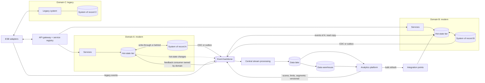

[Patterns](../patterns.md) › [Solution patterns](README.md)

# SOL-4 Operational Domain Mesh with Analytics Feedback

Also known as: hot-state domain mesh, closed-loop operational and analytical planes; Message Bus, Channel Adapter, Messaging Gateway, Canonical Data Model (EIP, for the integration edges).

**Intent.** Let each operational domain keep its hot state in memory, next to its own system of record, integrate the domains through an API gateway and an ESB without sharing their stores, stream their changes into an enterprise data platform, and feed analytical results back into the domains as owned, versioned inputs.

**Context.** A large enterprise runs many operational systems (orders, payments, customers, inventory, pricing, claims), each owned by a team and each with its own system of record. Some are modern services, some are legacy packages that speak only file, message-queue or SOAP-style interfaces. The enterprise also runs a central data platform: an event streaming backbone with a stream processor (for example Kafka with Flink), feeding a data lake and a data warehouse, on which an analytics platform builds models, scores, segments and limits. Those analytical results are only worth something once they reach the operational systems that act on them.

**Problem.** How do you give every operational domain memory-speed access to its working state, let domains and legacy systems cooperate without coupling their stores, get complete and trustworthy data into the lake and warehouse, and bring analytics back into operations, all without creating a second, unowned copy of the truth?

**Forces.**
- Domains need low-latency reads and writes on their hot state, which their systems of record alone cannot give at peak load.
- Each domain must keep owning its data. A shared operational store, or one domain reading another's in-memory state directly, couples their schemas, releases and failures.
- Legacy systems cannot be changed to speak modern APIs or publish events; they need adapters.
- The data platform needs every change, in order per entity, with a known schema. Applications that write to their store and publish an event as two separate steps lose or invent events when one step fails (the dual-write problem).
- Hot state that lives only in memory, or reaches the store late and coalesced, is not fully visible to change capture on the store.
- Analytical results are derived and lag operations by minutes to days, yet operational decisions will be taken on them.
- Every extra copy and every extra hop adds staleness, cost and a failure point.

**Solution.** Treat the enterprise as a mesh of owned operational domains on one side and a shared analytical platform on the other, joined by three kinds of edge: synchronous calls, asynchronous events, and a feedback channel.

*Inside each domain*

1. **One domain, one hot-state tier, one system of record.** Each domain runs its own in-memory data tier in front of its own system of record. Other domains never connect to it. Isolation is per domain, or per small group of domains with the same availability and security needs; one tier shared by unrelated domains brings back the coupling the mesh exists to remove.
2. **Decide authority per data class, and write it down.** For each data set the domain holds, say which copy is authoritative:
   - *Store-authoritative* (the default): the system of record holds the truth; the hot tier is a cache or read model, written through or fed by change capture. Use it for anything with legal, financial or audit weight.
   - *Memory-authoritative hot state*: short-lived working state (sessions, in-flight process state, live counters, reservations) whose truth is in memory and which reaches the store later, if at all. Use it only with an explicit loss budget and recovery plan.
   Never let both copies be authoritative for the same field.
3. **Serve the domain's APIs from hot state.** The domain's services answer reads and run state transitions against the in-memory tier, and persist through it or beside it according to step 2.

*Between domains*

4. **Synchronous edge: API gateway with discovery.** Modern domains publish their APIs through a gateway that finds instances through a service registry and applies authentication, rate limits, time-outs and versioning. A call reaches the owning domain's service, which answers from its hot state. The gateway exposes APIs, never a domain's data tier.
5. **Legacy edge: ESB as adapter.** Legacy systems join through an enterprise service bus that does protocol and format translation, routing and adaptation to a canonical message format. Keep business rules in the domains, not in the bus, so that a legacy system can later be replaced or moved behind the gateway without moving logic out of the bus. Treat the ESB as a set of adapters with an exit plan, not as the integration core.
6. **Asynchronous edge: events, not shared state.** When one domain needs another's data often, it subscribes to the owner's events and keeps a read copy in its own hot tier, tagged with source and version. The copy is eventually consistent; anything that must be current goes to the owner through the gateway.
7. **Cross-domain processes are sagas, not transactions.** A business process spanning domains is a sequence of local steps with compensations, driven by a process manager, each step idempotent.

*Into the data platform*

8. **Capture changes where they become true.** For store-authoritative data, capture changes from the system of record's log (change data capture), or write the event to an outbox table in the same transaction as the data. Both avoid dual writes. For memory-authoritative hot state, publish from the in-memory tier's own change stream, and accept its limits (see Consistency limits).
9. **One backbone, explicit contracts.** All domains publish to the event backbone with registered schemas, keyed by entity so that order is kept per entity. Domain events (business facts) and change events (row images) are different products; label them.
10. **Split the stream processing by purpose.** Enterprise-wide transformation, cleansing, joining across domains and loading into the lake and warehouse belong to the central stream processor. Low-latency processing on one domain's hot state (enrichment, live views, local decisions) belongs inside the domain, next to its data. Do not implement the same transformation in both places.

*Back into operations*

11. **Analytics publishes products, domains consume them.** The analytics platform publishes its results (scores, segments, limits, forecasts, reference data) as versioned data products: an event topic for incremental updates, a bulk interface for full refreshes. Each record carries the model or rule version and an as-of time.
12. **The owning domain loads them.** A consumer owned by the receiving domain loads the feedback into its hot tier, validates it, and decides how to act on it. Analytics never writes directly into a domain's store or hot tier.
13. **Fail safe on stale feedback.** Each feedback product has a freshness limit. Past it, the domain falls back to a defined default (last known good, a rule-based value, or a manual path) and raises an alert, rather than acting on old scores silently.
14. **Mark derived decisions.** Operational records that were influenced by a feedback value keep its version, so analytics can tell its own influence apart from independent behaviour when it retrains (otherwise the loop learns from its own output).

**Structure.**

**Composed of.**
- [ARCH-9 State Externalisation with In-Place Updates](../architecture-patterns/arch-09-state-externalisation-with-in-place-updates.md): each domain's services keep their working state in the hot tier.
- [IP-3 Write-Through](../caching-patterns/ip-03-write-through.md), [IP-2 Read-Through](../caching-patterns/ip-02-read-through.md): store-authoritative data.
- [IP-4 Write-Behind](../caching-patterns/ip-04-write-behind.md) with [IP-27 Write-Behind Loss Budget and Recovery](../caching-patterns/ip-27-write-behind-loss-budget-and-recovery.md): memory-authoritative hot state that is persisted later.
- [ARCH-6 Site Strategy per Data Class](../architecture-patterns/arch-06-site-strategy-per-data-class.md): the per-data-class decision of step 2 extended to resilience.
- [ARCH-8 Change-Fed Read Model](../architecture-patterns/arch-08-change-fed-read-model.md) and [ARCH-1 Operational Data Fabric](../architecture-patterns/arch-01-operational-data-fabric.md): read copies of other domains' data (step 6); ARCH-1 is the shape when one domain is a cross-domain read layer by design.
- [ARCH-12 Process Manager with Keyed State](../architecture-patterns/arch-12-process-manager-with-keyed-state.md) and [ARCH-5 Platform-Level Idempotency](../architecture-patterns/arch-05-platform-level-idempotency.md): cross-domain sagas (step 7).
- [STR-3 Data as Contract](../streaming-patterns/str-03-data-as-contract.md): schemas on the backbone (step 9).
- [STR-6 Durable Maps](../streaming-patterns/str-06-durable-maps.md) and [STR-10 Processing Guarantee](../streaming-patterns/str-10-processing-guarantee.md): in-domain pipelines that persist state and publish to the backbone.
- [STR-5 Enrichment Pipeline](../streaming-patterns/str-05-enrichment-pipeline.md) and [ARCH-10 Live Operational View](../architecture-patterns/arch-10-live-operational-view.md): low-latency processing inside a domain (step 10).
- [STR-12 Dead-Letter Side Output](../streaming-patterns/str-12-dead-letter-side-output.md): bad feedback records and bad inbound events are diverted, not dropped.
- [ARCH-7 Shared Reference Map with Near Cache](../architecture-patterns/arch-07-shared-reference-map-with-near-cache.md), [IP-5 Refresh-Ahead](../caching-patterns/ip-05-refresh-ahead.md), [IP-24 Freshness Separate from TTL](../caching-patterns/ip-24-freshness-separate-from-ttl.md): feedback data held in the hot tier and its freshness limit (steps 12 and 13).
- [IP-20 Tombstone with Version Guard](../caching-patterns/ip-20-tombstone-with-version-guard.md): late or echoed updates cannot overwrite newer state.
- [ARCH-2 Brownout and Degraded Mode](../architecture-patterns/arch-02-brownout-and-degraded-mode.md): behaviour when a dependency domain, the gateway, the bus or the feedback feed is down.

**Hazelcast mechanics.**
- *Isolation.* One cluster per domain (or per group of domains with the same needs), each with its own cluster name, sizing, upgrade cycle and, where needed, WAN replication for disaster recovery ([ARCH-6](../architecture-patterns/arch-06-site-strategy-per-data-class.md); WAN replication is Enterprise Edition). Sharing one cluster between domains is possible with separate maps and client permissions (security is Enterprise Edition), but domains then share members, memory, partition threads and maintenance windows.
- *Hot state.* IMaps with backups; `EntryProcessor` for atomic per-key transitions ([ARCH-9](../architecture-patterns/arch-09-state-externalisation-with-in-place-updates.md)). `MapStore` and `MapLoader` give write-through, write-behind and read-through to the system of record. Data that needs strong consistency (unique claims, counters, limits that must never be exceeded) goes in the CP Subsystem, for example `CPMap`, which is Enterprise Edition, needs at least three CP members, and is bounded in size (100 MB per map by default, at most 2,000 MB) and throughput per Raft group ([ARCH-5](../architecture-patterns/arch-05-platform-level-idempotency.md)).
- *To the backbone.* Pipelines read the map journal of a hot-state map and write to Kafka with the Kafka sink, which can be transactional (exactly-once into Kafka, with output visible only after each snapshot, [STR-10](../streaming-patterns/str-10-processing-guarantee.md)). The map journal is in memory and of fixed capacity: events overwritten before the job reads them, or lost with the cluster, are gone ([STR-7](../streaming-patterns/str-07-lost-journal-recovery.md)). For store-authoritative data, prefer CDC on the system of record outside Hazelcast.
- *From the backbone.* Pipelines with a Kafka source write read copies and feedback into IMaps with `Sinks.map` (an idempotent overwrite, so a replay in the original per-key order converges to the same state) or with an entry processor that applies a version guard ([IP-20](../caching-patterns/ip-20-tombstone-with-version-guard.md)). CDC sources (Debezium-based; Enterprise Edition) can feed a domain's own read models from its store ([ARCH-8](../architecture-patterns/arch-08-change-fed-read-model.md)).
- *Full refresh of a feedback product.* There is no atomic multi-key swap of an IMap. Load the new version into a new map, validate it, then switch a small pointer entry that readers consult to find the current map name; drop the old map after readers have moved. Readers can briefly use either version, which is acceptable only because each version is complete on its own.
- *Serving feedback.* Clients read scores and limits from IMaps, with a Near Cache where reads dominate ([ARCH-7](../architecture-patterns/arch-07-shared-reference-map-with-near-cache.md)); Near Cache updates are eventually consistent.
- *Scoring in the domain.* A model exported by the analytics platform can be applied inside a pipeline stage (`mapUsingService`, or the Python stage) next to the hot state, so real-time scores use current operational data and the platform only ships models and their versions.
- *SQL.* Domains can query their hot state and, through a Kafka mapping, topics on the backbone with SQL. Queries are not point-in-time snapshots across partitions.
- *What Hazelcast is not here.* It is not the API gateway, the service registry, the ESB, the enterprise backbone or the lake. A domain's cluster is not exposed through the gateway; its services are.

**Consistency limits.**
- IMap is AP. During a split-brain, both sides of a domain's cluster accept writes and the merge policy keeps one side, so hot-state updates can be lost. Use split-brain protection where that matters, and keep strongly consistent decisions in the CP Subsystem or in the system of record.
- There is no transaction across domains, or between a domain's hot tier and the backbone. Cross-domain consistency is eventual, through sagas with compensations and idempotent steps.
- With write-behind, the system of record lags memory and, with coalescing on (the default), receives only the latest value per key. CDC on that store therefore delivers coalesced history to the lake: intermediate states never exist there. If analytics needs every transition, publish from the hot tier's change stream, or turn coalescing off and size the queue, and say which in the data contract.
- Publishing from the map journal is not durable end to end: a full cluster loss, or a journal that wraps before the job reads it, loses events. Store-side CDC or an outbox is the durable path; the hot-tier stream is the low-latency one.
- A domain that feeds its own hot tier from CDC on a store it also writes through `MapStore` creates an echo: its own writes come back, possibly after newer ones. Do not do it, or guard every apply with a version ([IP-20](../caching-patterns/ip-20-tombstone-with-version-guard.md)).
- Order is kept per key within one backbone partition, not across keys, topics or domains. The lake can hold one domain's newer data next to another's older data; it is not a cross-domain snapshot unless the platform builds one.
- Delivery from the backbone into the hot tiers is at least once; every apply must be idempotent.
- Read copies of other domains' data and feedback values are stale by design. A read copy is never the basis for a decision that requires the owner's current state.
- Feedback latency is the sum of capture, central processing, lake and warehouse loads, model runs and publication: seconds for a streaming feature, hours or days for a batch model. Decide per product which one it is, and reflect it in the freshness limit.

**Consequences.**
- (+) Each domain gets memory-speed reads and state transitions, and its system of record sees less load.
- (+) Domains stay independently owned, deployable and scalable; a failing domain does not take the others' data tiers down with it.
- (+) Legacy systems take part without being changed, and can be replaced one at a time behind the bus or the gateway.
- (+) The data platform receives complete, ordered, schema-checked change streams instead of ad hoc extracts.
- (+) Analytics reaches operations through a defined, versioned, monitored channel, and every decision can be traced to the model version behind it.
- (−) Many moving parts: per-domain clusters, gateway, registry, bus, backbone, stream processor, lake, warehouse, analytics. Each needs owners, capacity and on-call.
- (−) Data exists in several copies with different lags. Without source, version and as-of on every record, nobody can tell which copy is right.
- (−) Memory-authoritative hot state trades durability for latency; the trade is safe only with a measured loss budget.
- (−) The ESB tends to collect business logic over time and becomes a coupling point of its own; this needs active governance.
- (−) Two stream-processing layers (in-domain and central) can duplicate logic and disagree; the split of step 10 has to be enforced in design reviews.
- (−) A closed analytical loop can amplify its own bias if derived decisions are not marked.

**When not to use it.** A few systems that one team owns, where a shared database and a batch export are enough; domains whose load their system of record already handles, where an in-memory tier adds cost and a copy without benefit; analytics that is reporting only, with no operational consumer; or an organisation without the platform teams to run a backbone, a lake and per-domain clusters. Start with one domain's hot tier and one feedback product, and grow the mesh as more domains need it.

**Related patterns.** [ARCH-1](../architecture-patterns/arch-01-operational-data-fabric.md), [ARCH-2](../architecture-patterns/arch-02-brownout-and-degraded-mode.md), [ARCH-5](../architecture-patterns/arch-05-platform-level-idempotency.md), [ARCH-6](../architecture-patterns/arch-06-site-strategy-per-data-class.md), [ARCH-7](../architecture-patterns/arch-07-shared-reference-map-with-near-cache.md), [ARCH-8](../architecture-patterns/arch-08-change-fed-read-model.md), [ARCH-9](../architecture-patterns/arch-09-state-externalisation-with-in-place-updates.md), [ARCH-10](../architecture-patterns/arch-10-live-operational-view.md), [ARCH-12](../architecture-patterns/arch-12-process-manager-with-keyed-state.md), [ARCH-13](../architecture-patterns/arch-13-server-side-filtered-subscriptions.md), [STR-3](../streaming-patterns/str-03-data-as-contract.md), [STR-6](../streaming-patterns/str-06-durable-maps.md), [STR-7](../streaming-patterns/str-07-lost-journal-recovery.md), [STR-10](../streaming-patterns/str-10-processing-guarantee.md), [STR-12](../streaming-patterns/str-12-dead-letter-side-output.md), [STR-14](../streaming-patterns/str-14-topic-based-publish-subscribe.md), [IP-20](../caching-patterns/ip-20-tombstone-with-version-guard.md), [IP-27](../caching-patterns/ip-27-write-behind-loss-budget-and-recovery.md), [SOL-3](sol-03-read-tier-for-ephemeral-clients.md).

**Background.** An enterprise reference architecture described by the project owner (2026-11-23). Hohpe and Woolf, *Enterprise Integration Patterns*, 2003 (Message Bus, Channel Adapter, Messaging Gateway, Canonical Data Model); Richardson, "Pattern: Transactional outbox" (microservices.io); Garcia-Molina and Salem, "Sagas", SIGMOD 1987; Fowler, "Microservices" (with Lewis, 2014), on smart endpoints and dumb pipes. Dehghani's "data mesh" applies domain ownership to analytical data products; this solution applies it to the operational side and treats analytical outputs as products consumed by the domains.

---

← [SOL-3 Read Tier for Ephemeral Clients](sol-03-read-tier-for-ephemeral-clients.md)
