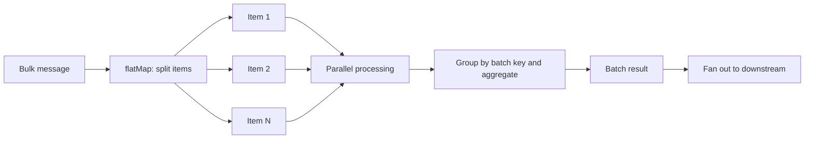

[Patterns](../patterns.md) › [Streaming patterns](README.md) › [Pipeline composition and data contracts](README.md#pipeline-composition-and-data-contracts)

# IP-10 Fan-in / Fan-out

Also known as: Debulk, Split and Aggregate.

**Intent.** Split, correlate and re-assemble streams of events.

**Context.** Events arrive in bulk (one message carries many items) or as related streams that must be matched.

**Problem.** How do you flatten bulk input, correlate related events and emit them again?

**Forces.**
- Downstream systems need single items; upstream sends batches.
- Related events arrive at different times.

**Solution.** Flatten bulk input into single events (fan-out), process them in parallel, then collect and correlate the results by a key into one outcome per batch (fan-in), and fan out again where needed. Fan-in needs a completion rule: a known item count carried in each item, a window, or a timeout.

**Structure.**

**Hazelcast mechanics.** `flatMap` for splitting. On an unbounded stream, a plain `aggregate` is not available: use `groupingKey(...).mapStateful(ttl, createFn, mapFn, onEvictFn)` to collect parts until the batch is complete, with `onEvictFn` handling batches whose parts never arrive (TTL is in event time and advances with the watermark), or windowed aggregation for time-bound correlation. `rollingAggregate` emits a running result per item, not one result per batch. To correlate two streams, use windowed co-grouping (`window(...).groupingKey(...).aggregate2(...)`) or a streaming SQL join. `hashJoin` joins a stream with a bounded (batch) source only.

**Consequences.**
- (+) Bulk and single-item flows share one pipeline model.
- (−) Correlation needs state held until all parts arrive, and a rule for parts that never come.
- (−) That state lives in the job's snapshots; it grows with the number of open batches.

**Related patterns.** [IP-8](ip-08-journal-chained-stages.md), [IP-11](ip-11-enrichment-pipeline.md).

---

← [IP-9 Data as Contract](ip-09-data-as-contract.md) · [IP-11 Enrichment Pipeline](ip-11-enrichment-pipeline.md) →
