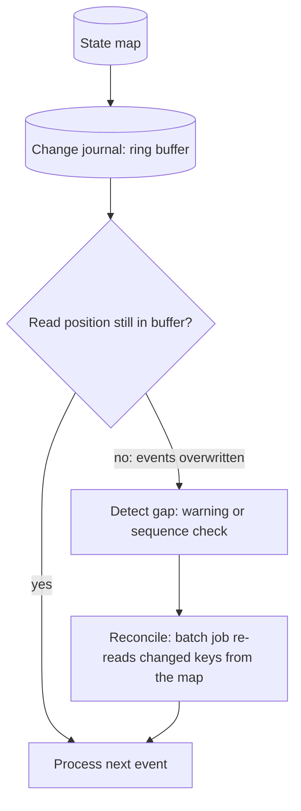

[Patterns](../patterns.md) › [Streaming patterns](README.md) › [Production concerns at the boundaries](README.md#production-concerns-at-the-boundaries)

# IP-13 Lost Journal Recovery

**Intent.** Detect when a change journal has dropped events and recover them.

**Context.** Stages are chained by change journals ([IP-8](ip-08-journal-chained-stages.md)), which are ring buffers with finite capacity.

**Problem.** What happens when load exceeds planned capacity and the journal overwrites events before the next stage reads them?

**Forces.**
- Fixed capacity bounds memory but can lose events under extreme load.
- Events must not be dropped silently.

**Solution.** Detect when a reader's position has fallen behind the oldest event still in the journal, alert on it, and reconcile the downstream state from the source map.

Do not assume the journal reader stops or notifies the pipeline when it falls behind; it may only log and skip ahead. Detection therefore means alerting on that signal, or reading with a source that compares the sequence it asked for with the first sequence it received. Recovery means finding which keys changed during the gap, which needs something in the data, such as a version number or last-updated timestamp per entry, and reprocessing those keys with a batch job over the source map.

**Structure.**

**Hazelcast mechanics.** The built-in `Sources.mapJournal` source does not stop or notify the pipeline: it logs a warning ("... events lost for partition ... due to journal overflow ..."), skips to the oldest available event, and carries on. Map journal `capacity` (`event-journal` config), which is shared across all partitions, sized to peak; log-based alerting or a custom `EventJournalReader` source for detection; a batch job over `Sources.map` with a predicate on the version or timestamp for reconciliation.

**Consequences.**
- (+) Loss is detected and repaired instead of passing unnoticed (the default behaviour is a log line).
- (−) Detection and recovery are application code that must be written and tested; recovery needs a version or timestamp field in the data.
- (−) Journal capacity still needs sizing to planned peak.

**Related patterns.** [IP-8](ip-08-journal-chained-stages.md), [IP-14](ip-14-backpressure.md).

---

← [IP-12 Durable Maps](ip-12-durable-maps.md) · [IP-14 Backpressure](ip-14-backpressure.md) →
