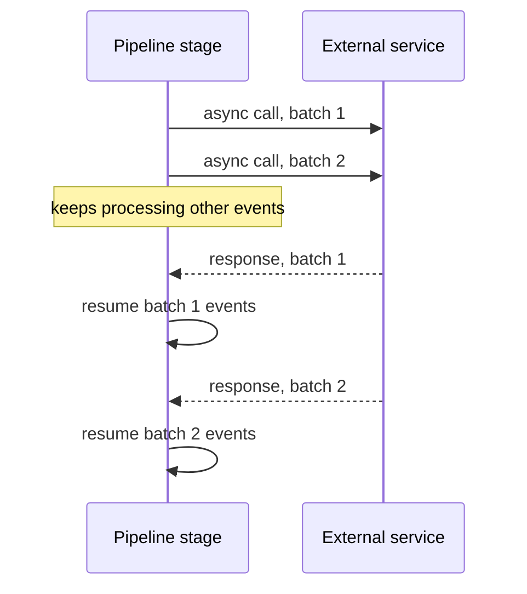

[Patterns](../patterns.md) › [Streaming patterns](README.md) › [Production concerns at the boundaries](README.md#production-concerns-at-the-boundaries)

# IP-16 Async Batched I/O

**Intent.** Call slow external services asynchronously and in batches.

**Context.** A pipeline must call external services that may be slow or variable.

**Problem.** How do you keep throughput high when individual calls are slow?

**Forces.**
- Blocking on each call stalls the pipeline.
- Batching raises per-event latency.

**Solution.** Group events into batches, send each batch asynchronously, keep processing other events, and resume each batch when its response arrives.

**Structure.**

**Hazelcast mechanics.** `mapUsingServiceAsync` (by default up to 4 concurrent operations per processor, preserving order; both configurable) and `mapUsingServiceAsyncBatched` (batches up to `maxBatchSize`, at most 2 batches in flight, always preserving order). Timeouts and retries are the user function's responsibility.

**Consequences.**
- (+) Throughput stays high even when single calls are slow.
- (−) Latency per event can rise.
- (−) The service must accept batches, or a stage must adapt them.
- (−) When the job restarts from a snapshot, replayed events call the service again; calls must be read-only or idempotent.

**Related patterns.** [IP-11](ip-11-enrichment-pipeline.md), [IP-14](ip-14-backpressure.md).

---

← [IP-14 Backpressure](ip-14-backpressure.md) · [IP-17 Processing Guarantee](ip-17-processing-guarantee.md) →
