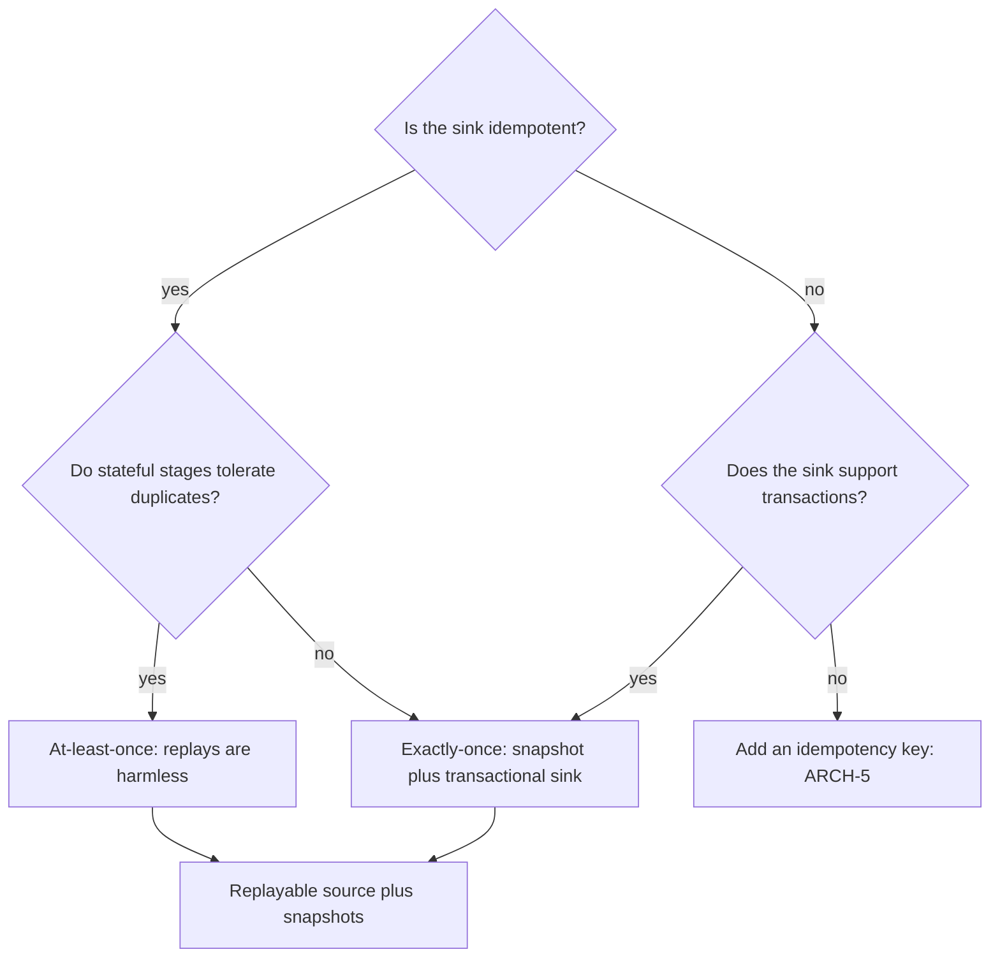

[Patterns](../patterns.md) › [Streaming patterns](README.md) › [Production concerns at the boundaries](README.md#production-concerns-at-the-boundaries)

# IP-17 Processing Guarantee

**Intent.** Choose at-least-once or exactly-once per pipeline.

**Context.** Pipelines write to sinks, and some downstream systems are legacy and not idempotent.

**Problem.** How do you make sure every event that enters a pipeline leaves its sinks the right number of times, through failures?

**Forces.**
- Exactly-once costs more latency and throughput than at-least-once.
- Some sinks cannot handle duplicates.

**Solution.** Combine snapshots with replayable sources. On failure, the job restarts from the last snapshot and replays the source from the matching offset. If the sink is idempotent and the job's stateful stages tolerate duplicates, choose at-least-once. Use exactly-once when stateful stages must not double-count, or for sinks that are not idempotent and support transactions.

**Structure.**

**Hazelcast mechanics.** `JobConfig.setProcessingGuarantee(...)` with `NONE`, `AT_LEAST_ONCE` or `EXACTLY_ONCE`, and a snapshot interval. With `AT_LEAST_ONCE`, snapshot barriers are not aligned, so after a restore a stateful stage (an aggregation, a dedup filter) can count some events twice. Transactional sinks include Kafka, JMS and JDBC (`Sinks.jdbcBuilder().exactlyOnce(true)`, which needs an `XADataSource`); `Sinks.map` gives exactly-once through idempotent overwrites. Replayable sources include Kafka and map journals (the latter only while events are still in the journal).

**Consequences.**
- (+) Guarantees hold through failure, provided the source can be replayed.
- (−) Transactional sinks commit on each snapshot, so their output becomes visible only after the next snapshot: output latency is at least the snapshot interval.
- (−) Snapshots are held in the cluster's memory. A full cluster loss loses them unless Persistence is configured, and then the source is replayed from wherever the job is restarted.
- (−) A guarantee inside the pipeline is not end-to-end once-only: an operation with external side effects also needs an idempotency key ([ARCH-5](../architecture-patterns/arch-05-platform-level-idempotency.md)).

**Related patterns.** [IP-12](ip-12-durable-maps.md), [ARCH-5](../architecture-patterns/arch-05-platform-level-idempotency.md).

---

← [IP-16 Async Batched I/O](ip-16-async-batched-io.md) · [IP-18 Partitioned Compute](ip-18-partitioned-compute.md) →
