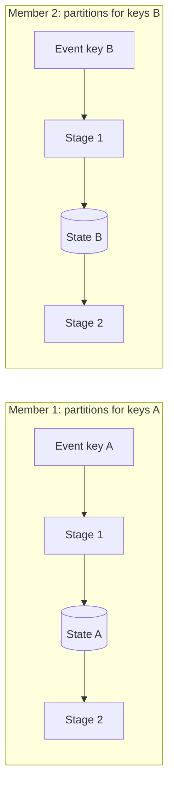

[Patterns](../patterns.md) › [Streaming patterns](README.md) › [Production concerns at the boundaries](README.md#production-concerns-at-the-boundaries)

# IP-18 Partitioned Compute

**Intent.** Process each event in the partition where its data lives.

**Context.** Stages read and write state that is partitioned across the cluster.

**Problem.** How do you avoid network hops between stages, and between compute and data?

**Forces.**
- Network hops dominate latency in chatty designs.
- Not every operation can be keyed by the same partition key.

**Solution.** Key events and state by the same key, so each event is processed on the node that owns its data, and successive stages run in the same partitions with no network hop between them.

**Structure.**

**Hazelcast mechanics.** Partition-aware keys (`PartitionAware`, or partitioning attributes on the map via `PartitioningAttributeConfig`); `groupingKey` in pipelines, which routes events with a partitioned edge using the cluster's partition table. Each partition is served by exactly one partition thread (there are fewer threads than partitions), so operations on a key run in order without locks. Sources such as Kafka are partitioned differently, so the first keyed stage after them always involves one network hop. Some lookups (for example keyed `mapUsingIMap`) assume the default partitioning strategy; check locality if you use a custom one.

**Consequences.**
- (+) Throughput scales with members while work spreads evenly across keys.
- (+) Scaling out adds members, which take over partitions with their own CPU and memory.
- (−) With auto-scaling on (the default), adding or removing a member restarts running jobs from their last snapshot.
- (−) A hot key stays on one partition thread and cannot be spread out.
- (−) Cross-key aggregates need a shuffle across members.

**Related patterns.** [IP-8](ip-08-journal-chained-stages.md), [IP-11](ip-11-enrichment-pipeline.md), [ARCH-9](../architecture-patterns/arch-09-state-externalisation-with-in-place-updates.md), [ARCH-11](../architecture-patterns/arch-11-orchestration-as-dataflow.md).

---

← [IP-17 Processing Guarantee](ip-17-processing-guarantee.md)
