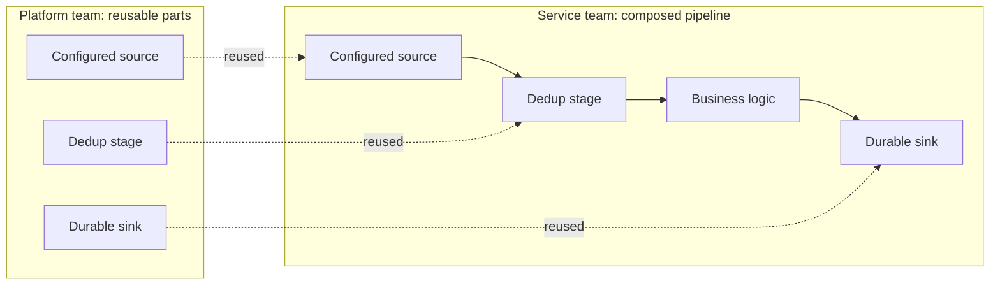

[Patterns](../patterns.md) › [Streaming patterns](README.md) › [Pipeline composition and data contracts](README.md#pipeline-composition-and-data-contracts)

# STR-1 Template Jobs

Also known as: Composable Pipelines; Pipes and Filters (EIP).

**Intent.** Platform teams build reusable pipeline parts; service teams compose them.

**Context.** Several teams build pipelines on one platform. Some specialise in the platform; others focus on business functions.

**Problem.** How do you let business teams build pipelines without each re-solving the platform plumbing?

**Forces.**
- Platform expertise is scarce; business logic changes often.
- Shared parts must stay stable while the pipelines that use them evolve.

**Solution.** The platform team publishes reusable sources, stages and sinks (for example a configured message-log source, a dedup stage, a durable sink). Service teams compose them with their own business stages into larger pipelines, and deploy each pipeline as its own job.

**Structure.**

**Hazelcast mechanics.** Pipeline stages packaged as Java functions or libraries (for example methods that return a `StreamSource`, apply a transform with `apply`, or return a `Sink`). Each composed pipeline is submitted as a separate job.

**Consequences.**
- (+) Divides work cleanly between platform and service teams.
- (+) Pipelines become the unit of change: logic is deployed separately from the platform, which reduces operational risk.
- (−) Shared parts become a dependency that needs versioning. A running job keeps the version it was submitted with; picking up a new version means resubmitting or upgrading the job.
- (−) Shared stateful parts (such as a dedup stage) carry snapshot state; changing their state format breaks restoring older snapshots.

**Related patterns.** [STR-2](str-02-journal-chained-stages.md), [STR-3](str-03-data-as-contract.md).

---

[STR-2 Journal-Chained Stages](str-02-journal-chained-stages.md) →
