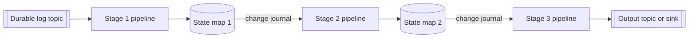

[Patterns](../patterns.md) › [Streaming patterns](README.md) › [Pipeline composition and data contracts](README.md#pipeline-composition-and-data-contracts)

# STR-2 Journal-Chained Stages

Also known as: Event-driven stage chaining; Pipes and Filters (EIP).

**Intent.** Each stage writes to a state map whose journal triggers the next stage.

**Context.** A flow has several processing stages, each like a microservice.

**Problem.** How do you chain stages so each reacts to the previous one, without point-to-point calls or polling?

**Forces.**
- Large systems are split into services, though everything could run in one stage.
- Stages should deploy independently, but hops between them add latency.
- The entry point must be durable and replayable.

**Solution.** A durable log feeds the first stage. Each stage writes its result to a state map. That map's change journal is the source of the next stage, and so on.

**Structure.**

**Hazelcast mechanics.** Kafka source for stage 1; `Sources.mapJournal(...)` as the source of each later stage; IMap sinks. The journal must be enabled per map (`event-journal` config). Its `capacity` (default 10,000) is the total for the map and is split evenly across partitions, so with 271 partitions the default holds only about 36 events per partition; size it for peak rate times the longest expected consumer pause. The two-argument `Sources.mapJournal` passes only ADDED and UPDATED events: if downstream stages must see removals or expiries, supply your own predicate. Map journals are partitioned, so each stage reads the changes local to its member.

**Consequences.**
- (+) The entry edge (Kafka) is durable and replayable. Journal edges are in-memory ring buffers: replayable only while the events are still in the buffer, and not kept across a full cluster restart.
- (+) State changes are events: downstream stages react at once, without polling or duplicate ingestion.
- (+) Every stage's state is queryable with SQL, once a mapping is created for each map.
- (−) Each hop is at-least-once: when a stage restarts from a snapshot it rewrites entries, and the journal emits those updates again. Downstream stages must tolerate repeated updates of the same key.
- (−) Journals have finite capacity and can drop events under extreme load ([STR-7](str-07-lost-journal-recovery.md)).

**Related patterns.** [STR-7](str-07-lost-journal-recovery.md), [STR-11](str-11-partitioned-compute.md), [ARCH-11](../architecture-patterns/arch-11-orchestration-as-dataflow.md).

---

← [STR-1 Template Jobs](str-01-template-jobs.md) · [STR-3 Data as Contract](str-03-data-as-contract.md) →
