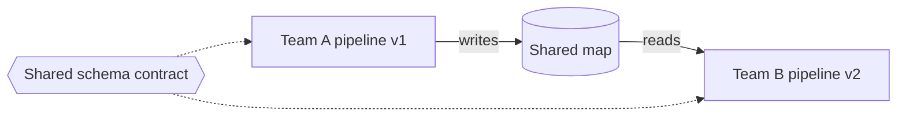

[Patterns](../patterns.md) › [Streaming patterns](README.md) › [Pipeline composition and data contracts](README.md#pipeline-composition-and-data-contracts)

# STR-3 Data as Contract

Also known as: Canonical Data Model, Format Indicator, Message Translator (EIP).

**Intent.** A shared schema lets pipelines evolve independently.

**Context.** Independent teams build pipelines that exchange the same messages.

**Problem.** How do you let pipelines change without breaking each other?

**Forces.**
- Parallel development needs a stable interface.
- Message formats change over time.
- A schema can be specific to one flow or canonical across flows.

**Solution.** Use a schema as the contract between stages, preferably an industry or canonical schema, and a serialisation format that supports schema evolution.

**Structure.**

**Hazelcast mechanics.** Compact serialisation. It supports adding and removing fields between versions; readers must check whether an optional field exists (`GenericRecord.getFieldKind` or the reader's `getFieldKind`) before reading it. Changing a field's type is not a compatible change. Schemas are replicated by the cluster itself, so no external schema registry is needed inside Hazelcast. On Kafka edges, the usual choice is Avro or Protobuf with a schema registry.

**Consequences.**
- (+) Pipelines can be developed and deployed independently.
- (+) Every stage can evolve on its own.
- (−) Compatibility rules must be agreed and enforced; nothing in Hazelcast rejects an incompatible change at write time.

**Related patterns.** [STR-1](str-01-template-jobs.md), [STR-2](str-02-journal-chained-stages.md).

---

← [STR-2 Journal-Chained Stages](str-02-journal-chained-stages.md) · [STR-4 Fan-in / Fan-out](str-04-fan-in-fan-out.md) →
