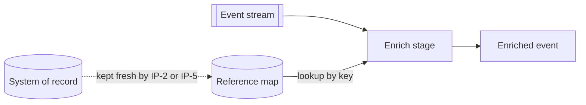

[Patterns](../patterns.md) › [Streaming patterns](README.md) › [Pipeline composition and data contracts](README.md#pipeline-composition-and-data-contracts)

# STR-5 Enrichment Pipeline

Also known as: Content Enricher (EIP).

**Intent.** Each event is enriched with reference data held in memory.

**Context.** Most events cannot be processed in isolation: they need lookup data.

**Problem.** How do you enrich every event without a remote database call per event?

**Forces.**
- Each lookup adds latency to the critical path.
- Reference data must be current enough for the decision.

**Solution.** Keep reference data in in-memory maps on the same cluster. The pipeline looks it up inside the processing stage, in memory. If the stage also updates the map, treat that as a side effect: it is not rolled back when the job restarts from a snapshot, so the update must be idempotent.

**Structure.**

**Hazelcast mechanics.** `mapUsingIMap` or `mapUsingReplicatedMap` stages. After `groupingKey(...)`, `mapUsingIMap` routes each event to the member that owns its key, so the lookup is local; this holds only with the map's default partitioning strategy. A ReplicatedMap keeps a full, eventually consistent copy on every member, so it suits small data sets. `hashJoin` suits small reference sets that do not change while the job runs: it loads the batch source once, when the job starts.

**Consequences.**
- (+) Lookups stay in memory and, with partitioned compute, local.
- (−) The reference data must be loaded and kept fresh.

**Related patterns.** [IP-2](../caching-patterns/ip-02-read-through.md), [IP-5](../caching-patterns/ip-05-refresh-ahead.md), [STR-11](str-11-partitioned-compute.md), [ARCH-7](../architecture-patterns/arch-07-shared-reference-map-with-near-cache.md), [ARCH-8](../architecture-patterns/arch-08-change-fed-read-model.md).

---

← [STR-4 Fan-in / Fan-out](str-04-fan-in-fan-out.md) · [STR-6 Durable Maps](str-06-durable-maps.md) →
