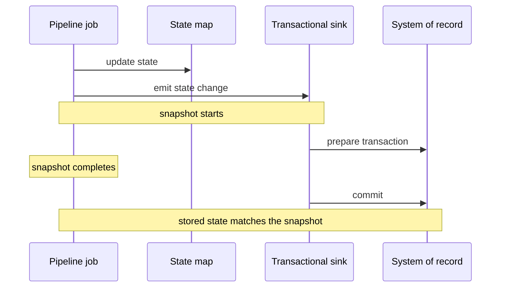

[Patterns](../patterns.md) › [Streaming patterns](README.md) › [Pipeline composition and data contracts](README.md#pipeline-composition-and-data-contracts)

# STR-6 Durable Maps

Also known as: Transactional Client (EIP).

**Intent.** Persist the state a pipeline keeps in in-memory maps to a system of record, with a clear rule for how far the stored copy can lag or lead the pipeline.

**Context.** State lives in in-memory maps, but a system of record must hold it durably.

**Problem.** When and how do you persist in-memory state so it stays consistent with what the pipeline has processed?

**Forces.**
- Writing every change is costly; writing too rarely risks losing state.
- Persisted state should line up with the pipeline's progress.
- Map state written by a sink is not part of the job's snapshot: when a job restarts from a snapshot, the map is not rolled back.

**Solution.** Pick one of two approaches.
1. **Map-level persistence.** Attach a store adapter to the state map, write-through ([IP-3](../caching-patterns/ip-03-write-through.md)) or write-behind ([IP-4](../caching-patterns/ip-04-write-behind.md)). Persistence runs independently of snapshots. After a restart, the pipeline reprocesses events since the last snapshot and rewrites the same keys, so the stored state converges as long as updates are deterministic upserts.
2. **Snapshot-aligned persistence.** Write to the system of record from a sink that takes part in the job's snapshot, so each snapshot is also a commit point. Transactional sinks do this when the job runs with an exactly-once guarantee: they prepare a transaction when a snapshot starts and commit it when the snapshot completes.

**Structure.**

**Hazelcast mechanics.** `MapStore` for option 1. For option 2: `Sinks.jdbcBuilder().exactlyOnce(true)` with an `XADataSource`, other transactional sinks (Kafka, JMS), or a custom `Processor` that implements `snapshotCommitPrepare` / `snapshotCommitFinish`; `ProcessingGuarantee.EXACTLY_ONCE` on the job.

**Consequences.**
- (+) Option 2 gives the system of record exactly the state of the last completed snapshot.
- (+) Option 1 needs no custom code and keeps the store close to memory.
- (−) Option 1: the stored state can run ahead of the last snapshot; correct only with idempotent, deterministic upserts.
- (−) Option 2: the database lags memory by up to one snapshot interval, and needs XA or an equivalent prepare/commit protocol.

**Related patterns.** [IP-3](../caching-patterns/ip-03-write-through.md), [IP-4](../caching-patterns/ip-04-write-behind.md), [STR-10](str-10-processing-guarantee.md).

---

← [STR-5 Enrichment Pipeline](str-05-enrichment-pipeline.md) · [STR-7 Lost Journal Recovery](str-07-lost-journal-recovery.md) →
