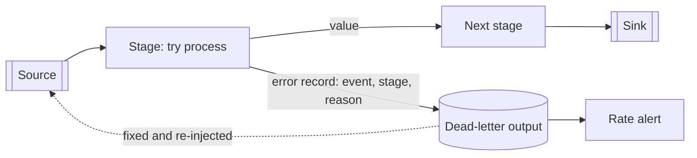

[Patterns](../patterns.md) › [Streaming patterns](README.md) › [Production concerns at the boundaries](README.md#production-concerns-at-the-boundaries)

# STR-12 Dead-Letter Side Output

Also known as: Dead Letter Channel, Invalid Message Channel (EIP).

**Intent.** Divert events that a stage cannot process to a separate output, with the reason, so one bad event does not stop the pipeline.

**Context.** A long-running pipeline processes events from many producers. Some events are malformed, violate a business rule, or hit a dependency error that retrying will not fix.

**Problem.** How do you keep processing the good events, without silently losing the bad ones?

**Forces.**
- Failing the whole pipeline on one bad event stops every good event behind it.
- Dropping bad events hides data-quality problems and loses data.
- Some failures are transient (retry) and some are permanent (divert); they need different handling.
- After a restart, events since the last snapshot are processed again, so a diverted event can be diverted twice.

**Solution.**
1. Inside each stage that can fail, catch the failure and return a result that is either the processed value or an error record: the original event, the stage name, the reason, and a timestamp.
2. Branch on that result: values continue downstream; error records go to a dead-letter output.
3. Retry transient failures a bounded number of times inside the stage first; divert only when retries are exhausted or the failure is permanent.
4. Key the dead-letter output by the event's identity, so a replay after restart overwrites rather than duplicates.
5. Alert on the dead-letter rate, and provide a way to re-inject corrected events at the pipeline's entry.
6. Decide per pipeline which failures should still stop it (for example, a broken dependency that would divert everything).

**Structure.**

**Hazelcast mechanics.** There is no built-in dead-letter output in a Jet pipeline: an exception that escapes a user function fails the job. With `JobConfig.setSuspendOnFailure(true)` the job is suspended instead, keeping its last periodic snapshot so it can be resumed, or upgraded (job upgrade is Enterprise Edition), once the cause is fixed. The `JobConfig` default is to terminate the job and delete its snapshots; jobs created with SQL `CREATE JOB` are set to suspend. (The error-handling page of the docs says streaming jobs suspend by default, which contradicts the `JobConfig` Javadoc; set the option explicitly.) Suspending is not a substitute for a side output: resuming replays the same bad event and fails again. The side output is built from ordinary stages: return a wrapper value from `map` or `mapUsingService`, then attach two `filter` stages to it, one per branch. The dead-letter sink can be an IMap keyed by event identity (queryable with SQL), or a Kafka topic when the dead letters must outlive the cluster. Errors raised inside a source, such as deserialisation in a connector, occur before user code; handle them by reading raw bytes and deserialising in a stage of your own.

**Consequences.**
- (+) One bad event no longer stops the pipeline; the bad events are kept with their reason.
- (+) Dead-letter rate becomes a data-quality metric.
- (−) Every stage that can fail needs the wrapper; the code is more verbose.
- (−) A dead-letter IMap is in memory and AP; it is lost on full cluster loss unless persisted or written to a durable log.
- (−) A dependency outage can divert every event; without a rule for when to stop instead, the dead-letter output fills with good events.

**Related patterns.** [STR-10](str-10-processing-guarantee.md), [STR-9](str-09-async-batched-io.md), [IP-26](../caching-patterns/ip-26-retry-safe-mapstore-batches.md) (the same idea at the store boundary), [STR-15](str-15-branching-pipelines.md).

---

← [STR-11 Partitioned Compute](str-11-partitioned-compute.md) · [STR-13 Claim Check](str-13-claim-check.md) →
