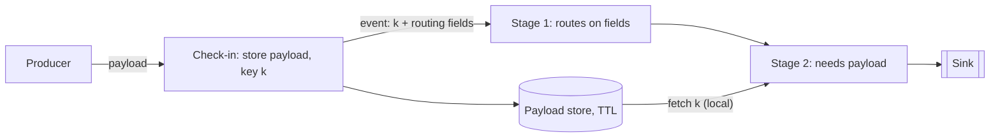

[Patterns](../patterns.md) › [Streaming patterns](README.md) › [Pipeline composition and data contracts](README.md#pipeline-composition-and-data-contracts)

# STR-13 Claim Check

Also known as: Claim Check (EIP), payload offload.

**Intent.** Store a large payload once in shared memory and pass only its key through the flow.

**Context.** Events carry large payloads (documents, images, big records) but most stages need only a few fields. The payload travels through logs, queues or pipeline edges between stages.

**Problem.** How do you stop large payloads from inflating every hop, log and snapshot, while the stages that need them can still get them?

**Forces.**
- Moving the payload through every stage costs network, log storage and serialisation at each hop.
- Message logs and brokers often limit message size.
- A stage that needs the payload must be able to fetch it quickly and reliably.
- The stored payload must not outlive its use for ever, nor disappear while it is still needed.

**Solution.**
1. At the entry point, store the payload under a unique key (the claim check) and replace it in the event with the key plus the few fields stages route on.
2. Stages that need the payload fetch it by key; others never touch it.
3. Store the payload partitioned by the same key the processing uses, so the fetch is local to the stage that needs it.
4. Give each stored payload a time to live longer than the longest time the event can take to finish, including replays after a restart. Optionally delete it when the flow completes.
5. Treat a missing payload as an error that goes to the dead-letter output, not as an empty value.

**Structure.**

**Hazelcast mechanics.** An IMap as the payload store, written with a per-entry TTL (or map-level `time-to-live-seconds`) and an eviction policy as a memory bound. In a pipeline, `mapUsingIMap` after `groupingKey` on the claim key fetches the payload from the member that owns it, as in [STR-5](str-05-enrichment-pipeline.md). Partition-aware keys let the payload share a partition with related state. The IMap is AP: a payload survives member loss within the configured backup count, not beyond it, and not a full cluster restart without Persistence (Enterprise Edition). For payloads that must be durable, store them in an object store and keep only a cached copy in the IMap. Expiry is applied lazily and by a background task, so memory is reclaimed somewhat after the TTL, not exactly at it.

**Consequences.**
- (+) Events stay small: logs, edges and snapshots shrink.
- (+) The fetch is an in-memory, usually local, lookup.
- (−) The flow now depends on the payload store; a lost payload is a failed event.
- (−) TTL sizing is a trade-off: too short loses payloads under backlog or replay, too long holds memory.
- (−) Memory use grows with in-flight payloads; size the store for the backlog, not the average.

**Related patterns.** [STR-5](str-05-enrichment-pipeline.md), [STR-11](str-11-partitioned-compute.md), [STR-12](str-12-dead-letter-side-output.md), [ARCH-3](../architecture-patterns/arch-03-burst-absorption.md) (backlogs lengthen payload lifetime).

---

← [STR-12 Dead-Letter Side Output](str-12-dead-letter-side-output.md) · [STR-14 Topic-Based Publish-Subscribe](str-14-topic-based-publish-subscribe.md) →
