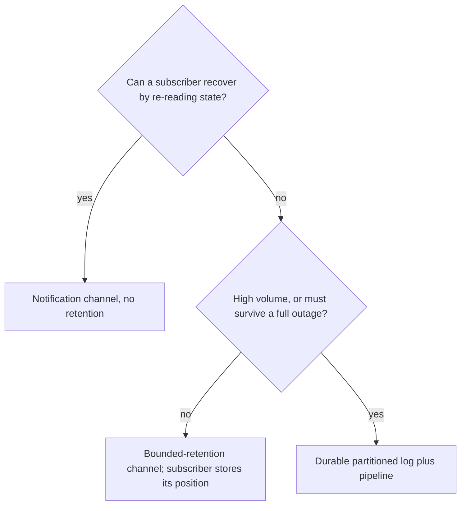

[Patterns](../patterns.md) › [Streaming patterns](README.md) › [Pipeline composition and data contracts](README.md#pipeline-composition-and-data-contracts)

# STR-14 Topic-Based Publish-Subscribe

Also known as: Publish-Subscribe Channel, Durable Subscriber (EIP).

**Intent.** Broadcast each message to every current subscriber, and choose the channel by how much loss and how much throughput each use can accept.

**Context.** Several consumers need the same notifications: cache invalidations, configuration changes, alerts, status updates. Consumers come and go.

**Problem.** Which kind of channel do you use, so that subscribers get what they need without overloading one node or losing messages they cannot afford to lose?

**Forces.**
- Fire-and-forget delivery is cheap but loses messages for subscribers that are down or slow.
- Retaining messages lets slow or restarting subscribers catch up, but retention is finite.
- A channel held on one node is limited by that node's throughput and memory.
- High-volume business events need a partitioned, durable log, not a notification channel.

**Solution.** Pick one of three channel kinds by use:
1. **Notification channel, no retention.** For signals where the latest state can be re-read elsewhere (for example "key X changed, re-read it"). Subscribers that are down miss messages and must resynchronise from the source on reconnect.
2. **Bounded-retention channel.** Messages are kept in a fixed-size ring. A subscriber records the position it reached and resumes from it, so short outages lose nothing. If a subscriber falls further behind than the ring holds, it has lost messages: decide whether it stops or carries on, and resynchronise.
3. **Durable partitioned log.** For business events at high volume, or that must survive a full outage, use a partitioned log outside the grid and consume it with a pipeline.

In every case, publish small messages (a key or a change notice) and keep the data in a map, so a subscriber that missed messages can recover by re-reading state.

**Structure.**

**Hazelcast mechanics.**
- Notification channel: `ITopic`. No retention; a listener only gets messages published while it is registered. Global ordering across publishers is off by default and costs throughput when enabled.
- Bounded retention: Reliable Topic, backed by a Ringbuffer (default capacity 10,000 messages, no TTL). A `ReliableMessageListener` gets messages in order without duplicates, can supply its starting sequence and store the last one it processed (a durable subscription, within retention), and declares whether it is loss-tolerant. A listener that is not loss-tolerant is terminated when it detects that messages it needed were overwritten. With a TTL set on the Ringbuffer, `TopicOverloadPolicy` decides what the publisher does when the ring is full of unexpired messages: `BLOCK` (default), `ERROR`, `DISCARD_NEWEST` or `DISCARD_OLDEST`. Without a TTL, old messages are simply overwritten.
- Scale: a Ringbuffer, and so a Reliable Topic, lives in one partition, on one member plus backups. One topic does not scale out with the cluster; spread load over several topics if needed.
- Durability: neither topic kind survives a full cluster restart without Persistence. A `RingbufferStore` can back a plain Ringbuffer and is asked for sequences no longer in memory.
- Durable partitioned log: Kafka (or similar) with a Jet Kafka source.
- For changes to map data, prefer an entry listener or the map journal on the map itself over publishing a separate message ([STR-2](str-02-journal-chained-stages.md), [ARCH-13](../architecture-patterns/arch-13-server-side-filtered-subscriptions.md)).

**Consequences.**
- (+) Simple fan-out to any number of subscribers, with no broker to run.
- (+) Bounded retention covers restarts and short outages.
- (−) A single topic is limited by one member; it is a notification channel, not an event backbone.
- (−) Retention is finite and in memory; a long outage still needs resynchronisation from state.

**Related patterns.** [STR-2](str-02-journal-chained-stages.md), [STR-7](str-07-lost-journal-recovery.md) (same loss-detection problem for journals), [ARCH-3](../architecture-patterns/arch-03-burst-absorption.md) (Ringbuffer and IQueue limits), [ARCH-13](../architecture-patterns/arch-13-server-side-filtered-subscriptions.md).

---

← [STR-13 Claim Check](str-13-claim-check.md) · [STR-15 Branching Pipelines](str-15-branching-pipelines.md) →
