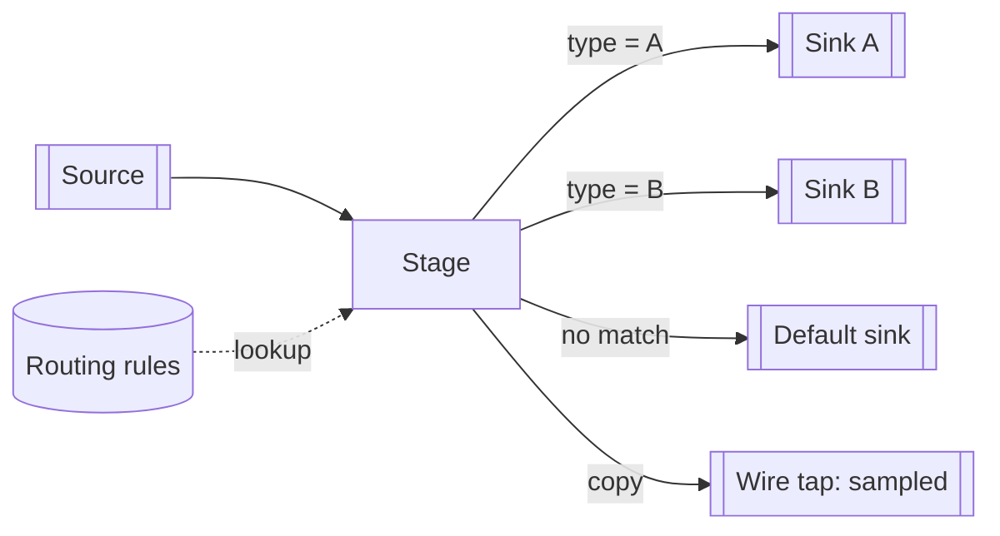

[Patterns](../patterns.md) › [Streaming patterns](README.md) › [Pipeline composition and data contracts](README.md#pipeline-composition-and-data-contracts)

# STR-15 Branching Pipelines

Also known as: Content-Based Router, Recipient List, Wire Tap, Detour (EIP).

**Intent.** Send each event to one or more outputs from inside a single pipeline: by content, to a fixed list, or as a copy for monitoring.

**Context.** One stream feeds several destinations. Some events go to one destination by their content; some go to all; operations want a copy of the flow to inspect.

**Problem.** How do you route and copy events inside a pipeline whose shape is fixed when it starts?

**Forces.**
- Routes defined in code are fast and checked, but change only when the pipeline is redeployed.
- Routes read from data change at run time, but only among outputs that already exist.
- Every extra output shares the pipeline's flow control: a slow output slows everything.

**Solution.**
1. **Route by content:** attach one branch per destination to the stage, each keeping only the events its predicate accepts. Make the predicates exhaustive and mutually exclusive, or add a default branch for events no predicate accepts.
2. **Fixed recipient list:** attach several outputs to the same stage; each receives every event.
3. **Wire tap:** attach a monitoring output to any stage. Keep it cheap, or sample, because it can slow the main flow.
4. **Run-time routing rules:** look up the rule per event in a small shared table, and pick among the existing branches. To add a new destination, deploy a new version of the pipeline; or use an output that selects its target per event, when the destination supports it.
5. **Detour:** a branch through extra validation, switched on by a flag read per event.

**Structure.**

**Hazelcast mechanics.** A Jet stage can feed any number of downstream stages; each receives every item. Route by content with one `filter` per branch (each branch evaluates its own predicate). Read run-time rules with `mapUsingReplicatedMap` (local, eventually consistent) or `mapUsingIMap`. The DAG is fixed when the job is submitted; changing it means a new job or a job upgrade (Enterprise Edition). Some sinks choose their target per item, for example the Kafka sink whose record function sets the topic for each record. Backpressure in a job is shared ([STR-8](str-08-backpressure.md)): a slow wire-tap sink slows the source; a stage-level sample keeps the tap cheap.

**Consequences.**
- (+) Routing, copying and tapping happen in memory, inside one job, with no broker hop.
- (+) A tap gives live visibility without changing the producers.
- (−) New destinations need redeployment unless the sink routes per item.
- (−) Overlapping or incomplete predicates send events twice or nowhere; a default branch catches the second case only.

**Related patterns.** [STR-1](str-01-template-jobs.md), [STR-8](str-08-backpressure.md), [STR-12](str-12-dead-letter-side-output.md) (a branch for failures), [ARCH-2](../architecture-patterns/arch-02-brownout-and-degraded-mode.md) (run-time switches).

---

← [STR-14 Topic-Based Publish-Subscribe](str-14-topic-based-publish-subscribe.md) · [STR-16 Resequencer](str-16-resequencer.md) →
