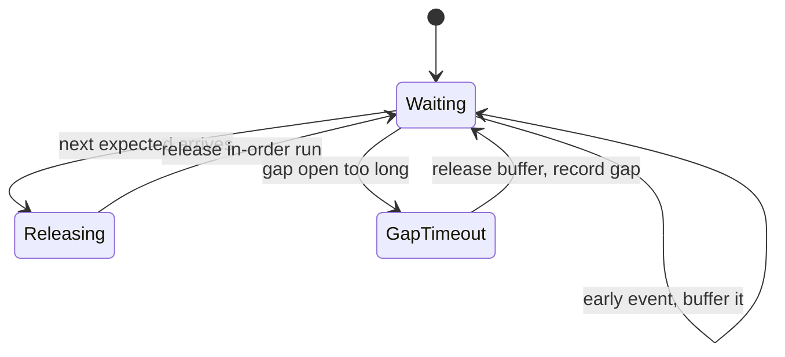

[Patterns](../patterns.md) › [Streaming patterns](README.md) › [Production concerns at the boundaries](README.md#production-concerns-at-the-boundaries)

# STR-16 Resequencer

Also known as: Resequencer (EIP).

**Intent.** Put out-of-order events for the same key back into sequence order before a stage that needs order.

**Context.** Events for one entity carry a sequence number, but arrive out of order: several producers, retries, or parallel processing upstream. A downstream stage (applying state changes, a ledger, a legacy consumer) needs them in order.

**Problem.** How do you restore order per key without holding events for ever when one never arrives?

**Forces.**
- Restoring order needs buffering, and buffering adds latency and memory.
- A missing event blocks everything after it unless there is a time limit.
- Total order across all keys is expensive and rarely needed; order per key usually is enough.
- Parallel processing increases throughput but can reorder events.

**Solution.**
1. Decide what order is needed: per key is the usual answer.
2. First, avoid creating disorder: route each key to one processing lane, and keep stages order-preserving where the cost is acceptable.
3. Where events still arrive out of order, keep per-key state: the next expected sequence and a buffer of early arrivals.
4. On each event, if it is the next expected, release it and any buffered events that now follow; otherwise buffer it. Drop or divert events older than the next expected (duplicates).
5. Bound the wait: when the gap has been open longer than a limit, release what is buffered and record the gap, or divert to the dead-letter output.
6. Bound the buffer per key, so one stuck key cannot use all memory.

**Structure.**

**Hazelcast mechanics.** No built-in resequencer. Build it with keyed state: `groupingKey(...).mapStateful(...)` or `flatMapStateful(...)`, which keep per-key state in the job's snapshots and have a TTL with an eviction callback for gap time-outs. The TTL runs in event time, advanced by the watermark, so it fires only while events keep arriving. Watermarks and windows handle late events for time-based aggregation; they do not restore arbitrary sequence order. To avoid disorder at the start, `Pipeline.setPreserveOrder(true)` stops Jet from reordering events between parallel processors (default false); it preserves the source's order per partition, not a total order, and it costs throughput. Keyed stages already process each key on one processor.

**Consequences.**
- (+) Downstream sees events in order per key.
- (−) Latency rises by the time events wait in the buffer, up to the gap limit.
- (−) Buffered events live in snapshot state; memory grows with keys that have gaps.
- (−) A gap limit turns a late event into a recorded gap; the consumer must accept that.

**Related patterns.** [STR-4](str-04-fan-in-fan-out.md), [STR-11](str-11-partitioned-compute.md), [STR-12](str-12-dead-letter-side-output.md), [IP-20](../caching-patterns/ip-20-tombstone-with-version-guard.md) (when last-writer-wins by version is enough, no resequencing is needed).

---

← [STR-15 Branching Pipelines](str-15-branching-pipelines.md)
