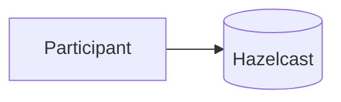

[Patterns](../patterns.md) › [Category name](README.md)

# PREFIX-n Pattern Name

Also known as: Other name (optional).

**Intent.** One line on what the pattern does.

**Context.** The situation in which the pattern applies.

**Problem.** The question the pattern answers.

**Forces.**
- A pressure that pulls one way.
- A pressure that pulls the other way.

**Solution.** What to do.

**Structure.**

**Hazelcast mechanics.** The Hazelcast features that implement it.

**Consequences.**
- (+) What you gain.
- (−) What you pay.

**Related patterns.** [PREFIX-n](prefix-nn-pattern-name.md), [OTHER-n](../other-category/other-nn-pattern-name.md).

---

← [Previous pattern](prefix-nn-previous.md) · [Next pattern](prefix-nn-next.md) →
