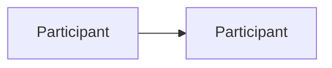

[Patterns](../patterns.md) › [Solution patterns](README.md)

# SOL-n Solution Name

Also known as: Other name (optional).

**Intent.** One line on what the solution achieves.

**Context.** The business situation and the systems involved.

**Problem.** The question the solution answers.

**Forces.**
- A pressure that pulls one way.
- A pressure that pulls the other way.

**Solution.** The idea, as numbered concepts. Technology-neutral.

**Structure.**

**Composed of.**
- [PREFIX-n Pattern Name](../category/prefix-nn-pattern-name.md): its role in this solution.

**Hazelcast mechanics.** The Hazelcast features that implement it, at the level of features and APIs.

**Consistency limits.**
- What the guarantees do not cover, and how the solution fails safe.

**Consequences.**
- (+) What you gain.
- (−) What you pay. Quote measurements only with their conditions.

**When not to use it.** Situations where a simpler pattern is better.

**Related patterns.** [PREFIX-n](../category/prefix-nn-pattern-name.md).

**Background.** Papers, articles or proofs of concept the solution draws on.

---

← [Previous](sol-nn-previous.md) · [Next](sol-nn-next.md) →
